# Forma-1 telemetria elemző alkalmazás készítése

Novák József Pál

Szakdolgozati munkaváltozat.

## Összefoglaló

A PitWall Insights böngészőben futó alkalmazás a Forma-1 nyilvános versenyadatainak elemzésére. A dolgozatban azt vizsgálom, hogyan lehet az eltérő időrendben érkező köridőket, pozíciókat és versenyirányítási jelzéseket közös időalapra hozni, majd ugyanabból a tárolt adathalmazból visszajátszást és egy adott versenypillanathoz kötött stratégiai számítást készíteni.

Az alkalmazás az OpenF1 történeti adatait PostgreSQL-adatbázisban tárolja. A külön futó feldolgozó a kiválasztott pilótákhoz és nézethez készíti elő a részletes méréseket. A böngészőben ugyanazt a lejátszási időpontot követi a térkép, a sorrend és az elemzőfelület. A személyes panelelrendezések menthetők és eltérő típusú munkamenetekhez rendelhetők.

A stratégiai modul köridőkből és szektorátlépésekből becsli a gumitempót, a kiállási időveszteséget és a közvetlen riválisokhoz várható viszonyt. Az incidensek történeti gyakorisága külön kerül a várható bokszköltségbe, az esőgumi-váltás pedig rövid távú összehasonlítást kap. A visszajátszási és mérési próbák rögzítik, hogy mely eredmény vezethető le az adott pillanat adataiból, és melyik marad feltételes. A szerver a mentett elrendezések és a haladó vizsgálatok elérését három csomaghoz ellenőrzi. A fizetési és Google-integráció szolgáltatói próbája hátravan. Az MI-alapú magyarázat és az automatikusan frissülő tartalmi oldalak tervezettek.

## Abstract

PitWall Insights is a browser-based application for analysing public Formula 1 data. This thesis describes how lap timing, positions and race-control events are aligned to a shared clock and used for both historical replay and strategy evaluation at a selected moment of the race.

The application stores historical OpenF1 records in PostgreSQL. A separate worker prepares detailed samples for the drivers and views that require them. The circuit map, running order and analysis panels use the same replay position. Personal dashboard layouts can be saved and limited to compatible session types.

The strategy module estimates tyre pace, net pit-stop loss and the likely position relative to rivals from lap and sector timing. Historical incident frequencies inform expected pit costs, and weather transitions use a separate short-horizon comparison. Replay and measurement tests distinguish results supported by the data available at the decision cutoff from conditional estimates. The server enforces three plans for saved layouts and advanced analysis. Hosted payment and Google sign-in still require provider testing. AI explanations and automatically refreshed content remain planned.

## 1. Bevezetés

### 1.1. A feladat háttere és motivációja

Egy nagydíjon a sorrendből hamar látható, ki előzött, de egy kiállás időzítését a sorrend önmagában nem magyarázza meg. Az előtte haladó pilóta egy rossz kerékcsere után még akkor is közvetlen rivális maradhat, ha a pályán több hellyel hátrébb kerül. Esőben egyetlen szektor is megmutathatja, hogy megváltozott a tapadás, miközben a teljes kör ideje csak a következő célvonalátlépéskor válik ismertté. Ezekhez a helyzetekhez a köridők mellé időközök, gumikor, bokszadat és a versenyirányítás jelzései is kellenek.

A PitWall Insights célja, hogy a felhasználó megállíthasson egy történeti futamot az érdekes pillanatnál, visszanézhesse az előzményeket, és összevethessen néhány szakmailag értelmezhető lehetőséget. Egy nézőnek a pálya és a sorrend ad támpontot. A részletes vizsgálatot a szektoridők, a gumietapok és a kiállás következményeit bemutató panelek segítik. Ugyanaz a felhasználó a választott vizsgálathoz igazíthatja a munkaterületet.

### 1.2. Célkitűzés és önálló hozzájárulás

Saját feladatom volt az adatbetöltés, a normalizálás és a tartós tárolás megtervezése, a telemetria igény szerinti előkészítése, valamint a böngészős visszajátszás és a szerkeszthető elemzőfelület megvalósítása. A stratégiai modulhoz mérőszámokat, előfeltételeket és forgatókönyveket dolgoztam ki, majd ezeket a lejátszásban is használható szolgáltatássá kapcsoltam össze. A külső forrás az alapmegfigyeléseket adja. A tiszta kör kiválasztása, a riválisokhoz viszonyított időveszteség, az időkorlát kezelése és a terveket rangsoroló eljárás a PitWall Insights része. [2, 5, 6]

Az önálló labor során gyűjtöttem össze az első adat- és megjelenítési ötleteket. A szakdolgozati félévben jutottam el az egységes adatmodelltől a történeti használati folyamatig. A jelenlegi ellenőrzés a kijelölt, túlnyomórészt 2023 és 2025 közötti munkamenetekre és néhány későbbi regressziós esetre vonatkozik. Az időpont alapján vizsgált történeti adat és az élő adatfogadás önálló feladat. Utóbbihoz külön hozzáférés és az adatok beérkezési sorrendjének rögzítése szükséges. [1, 12]

## 2. Szakmai és technológiai háttér

### 2.1. Versenyadatok és értelmezési határok

A munkamenet egy edzéshez, időmérőhöz, sprintfutamhoz vagy nagydíjhoz tartozó vizsgálati egység. Egy hétvégén több ilyen egység van. Egy pilóta köradatai ezért a munkameneten belüli részvételhez kapcsolódnak, amely a rajtszámot és az akkori csapatot is rögzíti. Az etap az egy gumiszettel teljesített, egymást követő körökből áll. Az autótelemetria sűrűbb idősor. Ide tartozik például a sebesség, a gázállás, a fordulatszám és a fékjel. A pályapozíció külön mérési sorban érkezik.

A köridőt érdemes a körülményekkel együtt vizsgálni. A biztonsági autó, az eső, a forgalom és a bokszkiállás más eloszlást adhat, mint a zavartalan futás. A köridőszórásból önmagában gyenge következtetés adódna a pilóta egyenletességére, ha a lassú bokszkört is beleszámolnánk. A gumidegradáció vizsgálatához hasonló korú és körülmények között futott szettekre van szükség. A nyilvános fékjel bináris, a sebesség a teljes járműé. A kerékblokkolás megerősítéséhez külön kerékfordulatszám kellene. [12, 19]

### 2.2. Az OpenF1 mint aktív adatforrás

Az OpenF1 HTTP-végpontjai a szolgáltató munkamenet-azonosítója köré szerveződnek. Az API történeti lefedettsége 2023-ban kezdődik. A történeti hozzáférés nyilvános, a valós idejű szolgáltatás előfizetéses. A PitWall Insights a történeti adatokhoz a saját alkalmazásfiókját használja. [12]

| Adatkör | OpenF1-erőforrások | Alkalmazásbeli szerep |
| --- | --- | --- |
| Naptár, résztvevők, eredmény | meetings, sessions, drivers, starting_grid, session_result | Munkamenet-választás, rajtsorrend, végső eredmény |
| Körök és gumik | laps, stints | Kör- és szektorelemzés, gumietapok, stratégiai alapadat |
| Autó és pálya | car_data, location | Sebesség, pedáljelek és pályapozíció |
| Sorrend és időveszteség | position, intervals, pit | Időmérő torony, riváliskülönbség, kiállási költség |
| Körülmények és közlések | weather, race_control, team_radio | Időjárás, zászlók, közölt események és elérhető rádiórészletek |

Az egyes erőforrások lefedettsége eltérhet. Időköz hiányában azonos mérési vonalat átlépő pilóták között képezhető időbeli különbség, ha mindkét átlépés megvan. A mérési helyen kívüli mozgás csak a pozíciósor folytonossága és a pályarajz illeszkedése alapján becsülhető. A forrás pályaszintű csapadékjelzése önmagában nem írja le egy kanyar vizesedését vagy a közelgő esőt. Az adattípus és az eredet ezért a levezetett értékkel együtt kerül a panelre. [12]

### 2.3. A technológiaválasztás indokai

A TypeScriptet a panelek és az API szerződései miatt választottam. A szerkesztő, az előnézet és a futamnézet ugyanazokkal a paneltípusokkal és paraméterekkel dolgozik. A statikus típusok már fordításkor megmutatják, ha egy új beállítás valamelyik fogyasztóból kimaradt. Az importált és mentett adatok futásidejű ellenőrzése ettől függetlenül szükséges. [20]

A React komponensmodellje alkalmas arra, hogy ugyanazt a térképet, táblázatot vagy grafikont több elrendezésben használjam. Az egyes panelpéldányok saját beállításai mellett Contextben adom át a munkamenethez tartozó közös kiválasztást. A sűrűn változó lejátszási jelre csak az azt használó komponensek iratkoznak fel. [9]

A TanStack Query a szerverválaszok életciklusát kezeli. Ugyanaz a kérés megosztható a megfelelő panelek között, az eltérő időpontra, pilótára vagy munkamenetre szóló adat pedig eltérő kulcsot kap. Erre támaszkodik a visszatöltés és a korábbi eredmény megtartása addig, amíg az új lekérés még folyamatban van. [10]

A Python a forrásadatok feldolgozásához és a számítási kódhoz egyaránt használható. A numerikus modellek először önálló függvényekben, kis példákon ellenőrizhetők. A NumPy és a SciPy a mátrixos illesztéseknél és a statisztikai számításoknál adnak bevált eszközöket, miközben a bemenet kiválasztása és a versenyszabályok az alkalmazás saját kódjában maradnak. [2, 6]

A FastAPI és a Pydantic választását az indokolta, hogy a HTTP-kéréshez tartozó típus, a futásidejű validáció és az OpenAPI-leírás ugyanazokra a modellekre épülhet. Az API rövid műveleteket kezel. A szolgáltatói letöltés és a tömeges átalakítás külön Python-folyamatban fut, így az állapot lekérdezhető az előkészítés alatt is. [21]

A PostgreSQL-ben egy helyen tárolható a munkamenetek relációs adata, a telemetria és a háttérfeladatok állapota. A körök és résztvevők kapcsolatát idegen kulcsok, a párhuzamos írást tranzakciók és egyediségi szabályok védik. A COPY eljárás nagyobb telemetria-adagrészek betöltésénél is használható, ezért a prototípushoz külön idősor-adatbázis vagy objektumtár nélkül is vizsgálható volt a késleltetés. [8]

Az SQLAlchemy kezeli a relációs modellek, lekérdezések és tranzakciók alkalmazásszintű leírását. A nagy telemetria-íráshoz a PostgreSQL saját műveletét a psycopg kapcsolaton át használom. Az Alembic verziózott migrációi ugyanazokat a mezőket és indexeket hozzák létre a fejlesztői és az elkülönített tesztsémában. [22, 23]

A Vite gyors helyi fejlesztői visszajelzést és önálló produkciós csomagot ad a böngészős kódhoz. A Playwrightot a több lépést átfogó próbákhoz használom. Egyetlen böngészős tesztben végigjárható a bejelentkezés, a futam megnyitása, a léptetés és egy panel megjelenése. [2, 4, 24]

### 2.4. Közös időalap és adatminőség

A forrás időzónás időpontját a munkamenethez rögzített origóból számolt ezredmásodpercre alakítom. A rajtot a lejátszás felülete ettől eltérő nullpontként mutathatja. Két idősor összehasonlításakor a tárolt közös órát használom, így a megjelenített eltelt idő változása nem tolja el a rádiót, a pozíciót vagy a zászlót egymáshoz képest.

A normalizálás egyezteti a mértékegységet, az időpontot és a kapcsolódó résztvevőt. Az alkalmazás a hiányzó vagy törölt köröket, a megszakadó órát és a bizonytalan pályaállapotot az összehasonlíthatóság részeként kezeli. A minősítés szabályverziója és az elutasítás oka megmarad. Új, például a szélirányból számított mennyiséghez külön modell és eredetjelölés tartozik.

A sűrű adatsoroknál a tárolási és megjelenítési felbontás eltér. A teljes futam térképéhez elég lehet egy ritkább, végig egyenletesen lefedett sor. Fékezési pont vagy időmérős kör elemzéséhez szűkebb időablakon részletesebb adat is lekérhető. Az eltérő felbontás az alkalmazásban ugyanarra a tárolt időalapra épül.

## 3. Követelményspecifikáció

### 3.1. Használati esetek

A bejelentkezett felhasználó történeti munkamenetet választ, majd visszanézhet egy kiválasztott kört vagy végigjátszhatja a futamot. A munkaterületen a részletes csatornák az elrendezés és a kijelölt versenyzők alapján készülnek elő. A felhasználó saját panelelrendezést menthet, és a visszajátszás egy adott pontján összevetheti a pályán maradást és a kiállást. E három folyamatból vezettem le a megfigyelhető működést és a tesztelhető minőségi elvárásokat.

### 3.2. Funkcionális követelmények

| Azonosító | Követelmény | Elfogadási feltétel |
| --- | --- | --- |
| F01 | Saját fiók és profil | A regisztráció és a bejelentkezés működik, a profilváltozás visszaolvasható. |
| F02 | Történeti munkamenet-választás | A választás egyértelmű forrásazonosítóhoz tartozik, elérési hibánál indok jelenik meg. |
| F03 | Alapadat és igény szerinti telemetria | Az előkészített csatornák a megfelelő munkamenethez és pilótához lekérhetők. |
| F04 | Visszajátszás | A lejátszás indítható, szüneteltethető és léptethető a teljes tárolt tartományon. |
| F05 | Összehangolt megjelenítés | A térkép, a kijelölt pilóták paneljei és a sorrend ugyanazt a lejátszási állapotot követik. |
| F06 | Személyes elrendezés | A példányok és beállításaik mentés után visszaállnak, az érvénytelen elhelyezés elutasítható. |
| F07 | Számított mutatók | Az eredményhez érték, mértékegység, eredet és elérhetőség tartozik. |
| F08 | Időponthoz kötött stratégiai elemzés | A jövőbeli megfigyelés kizárt, a terv feltételei és az alternatíva megjelennek. |
| F09 | Adatkészültség | A sorban álló, folyamatban lévő, kész és hibás állapot külön megjelenik. |
| F10 | MI-alapú magyarázat | A válasz azonosítható körökkel és számított értékekkel összeköthető. |
| F11 | Előfizetés és tesztfizetés | A szerver a tesztfizetés igazolt állapotából vezeti le a csomagjogosultságot. |
| F12 | Tartalmi oldalak | A kezdőoldal, a bajnoki állás és a hírfolyam valódi tartalmat ad, forrásjelöléssel. |

### 3.3. Nem funkcionális követelmények

| Azonosító | Követelmény | Ellenőrizhető feltétel |
| --- | --- | --- |
| NF01 | Indulási idő | A kiválasztott teljes mezőny előkészítési és indulási célja 180 s, helyi forrásgyorsítótárral és még hiányzó adatbázis-telemetriával. |
| NF02 | Követhető háttérmunka | Az API státuszt ad, a nem működő worker felismerhető. |
| NF03 | Időbeli és numerikus következetesség | Későbbi adat vagy hiányzó mérés nem változtatja meg igazolatlanul a vizsgált pillanat eredményét. |
| NF04 | Tulajdonosi elkülönítés | Idegen fiók nem fér hozzá a személyes profilhoz, elrendezéshez és elemzési kontextushoz. |
| NF05 | Ismételhető előkészítés | Az azonos vagy átfedő kérés újrahasználja a kész adatrészt, a párhuzamos írás konzisztens. |
| NF06 | Használható felület | A választás betöltés közben megmarad, a panelek és a sorrend keskeny kijelzőn is használhatók. |
| NF07 | Ellenőrizhetőség | A modulhatárok, a sémaváltozások és a mérési feltételek követhetők. |

Az NF01 értéke teljes mezőnyre kijelölt mérési cél. A felhasználó által érzékelt várakozásba a hálózat, a gyorsítótár állapota és a kiválasztott csatornák is beleszámítanak. Az F08 elfogadása a meghatározott bemenetekre és a visszajátszásra vonatkozik. A modell több futamra általánosítható pontossága önálló kérdés. Az F10-F12 az alkalmazás tervének része, ezekhez a 8. fejezet rögzíti a következő fejlesztési lépéseket.

## 4. Rendszerterv

### 4.1. A fő komponensek felelőssége

A böngésző a PitWall API-n keresztül kéri a munkamenet és az elemzés adatait. Az API ellenőrzi a felhasználót és a paramétereket, tárolt adatra válaszol, vagy bejegyzi az előkészítési igényt. A külön futó feldolgozó a PostgreSQL-ben tárolt munkasorból veszi fel a feladatot. Utána ugyanitt rögzíti az eredményt, a böngésző pedig az API-n át követi az állapotot.

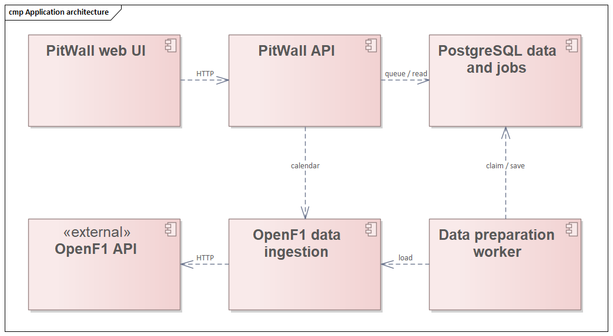

Az adatforrás-adapter a szolgáltatói rekordokat alakítja át. A normalizáló modul egységes munkamenet-pillanatképet állít elő, a tárolási réteg pedig kezeli a kapcsolatokat és a lekérdezéseket. Az elemzőmodul az előkészített adaton számolja a jellemzőket. A döntési modul ezekből vizsgálható forgatókönyveket és hozzájuk tartozó becsléseket készít. A saját fiók, a mentett elrendezés és az elemzési kontextus tulajdonosát a szerver a hitelesített kérésből állapítja meg. [2, 3]

A program moduláris backendből és külön feldolgozófolyamatból áll. A szolgáltatások a Python-kódon belül hívják egymást. A különálló worker a hosszú művelet határa, az adatbázis pedig a közös műveleti állapoté. Így egy új mérőszám vagy panel felvétele a legtöbb esetben az elemzési és a megjelenítési rétegre korlátozódik.

### 4.2. Adatmodell és a hozzáférés szétválasztása

A munkamenet egy szezon hétvégéjéhez tartozik. Ezen belül az autó és a pilóta szereplését egy résztvevői rekord írja le. A kör, az etap, az autótelemetria és a pozícióminta ehhez a rekordhoz kötődik. Az idő szerinti olvasást indexek segítik. A pilóta és a történeti munkamenet kapcsolatát azért ebben a rétegben rögzítem, mert a pilóta csapata vagy a rajtszáma később változhat.

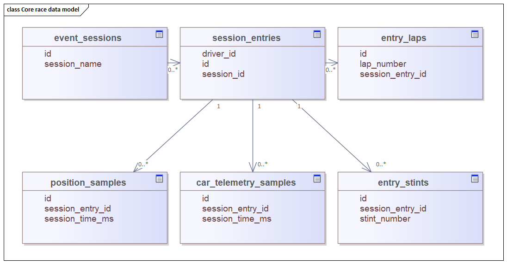

A szegmens azt rögzíti, hogy mely résztvevő, csatorna és tartomány adata újrahasználható. A feldolgozási feladat a munka életciklusát írja le. Ha a lekért tartomány már megvan, egy új igény közvetlenül azt használja. A forrásválasz-gyorsítótár a letöltést, a normalizált adatbázis az átalakítást és az írást, a számítási gyorsítótár pedig a mérőszámok ismételt előállítását válthatja ki. Az eltérő újrafelhasználási szintek miatt a mérési jegyzőkönyv mindegyik kezdeti állapotát külön rögzíti.

A személyes elrendezés a panelpéldányok azonosítóit, geometriáját és paramétereit tárolja. A futamadatot hivatkozásként használja. A köridő vagy telemetria ettől egy helyen marad, miközben két felhasználó eltérő összeállítást menthet. A szerver a privát adat tulajdonosát, a munkamenethez tartozó résztvevőt és az engedélyezett tartományt külön ellenőrzi. Az előnézet típusrajzzal épül fel, ezért a sablonok között akkor is lehet választani, amikor a munkamenet részletes mérései még készülnek.

### 4.3. A numerikus és a döntési réteg kapcsolata

A mérőszámok újrafelhasználásához a megfigyelés forrása, az időkorlát és az egység külön mező. Egy szektorátlépésből képzett különbség ugyanazt jelenti a riválispanelen és a bokszablak számításában. A becsült időveszteség mellé a felhasznált esetek száma és a korlátok is visszakerülnek. A következő réteg így eldöntheti, hogy az értéket összehasonlításhoz, érzékenységi vizsgálathoz vagy feltételes döntéshez használhatja-e.

A rendszer konfigurált stratégiai vizsgálatra és automatikus visszajátszási javaslatra is képes. Az első megadható privát pályageometriát, gumigörbét vagy kalibrációs paramétereket használhat. A visszajátszás döntési útja a tárolt futamadatok, korábbi megfigyelések és kifejezett modellfeltételek alapján állít elő terveket. A két út közös bemeneteit és a felületi célját az 5.4. alfejezet folyamatábrája mutatja.

## 5. Az alkalmazás megvalósítása

### 5.1. Az adatbetöltés szervezése

#### 5.1.1. Katalógus, alapimport és forráskezelés

A katalógus egy év eseményeiből állítja össze a választható edzéseket és futamokat. A választáshoz az OpenF1 saját munkamenet-azonosítóját tárolom. Egy helyszín vagy egy nagydíj szöveges neve önmagában nem egyedi, különösen akkor, ha a hétvége elnevezése vagy pályakonfigurációja idővel megváltozik.

Az alapimport a névsort, a köröket, az etapokat és az elérhető körülményadatokat készíti elő. A részletes autó- és pozícióméréseket az elrendezés adatigénye alapján töltöm be. A sorrend megtekintéséhez nem kell megvárni az összes versenyző részletes helyzetmintáit. Egy sebességgrafikonhoz elég a kiválasztott autó adatsora, a pályatérkép külön pozíciócsatornát használ.

A szolgáltatói adapter, a HTTP-kliens és a forrásválasz-gyorsítótár külön felelősséget kapott. A kliens időkorlátot, válaszméret-korlátot és korlátozott újrapróbálást alkalmaz. Figyelembe veszi a szolgáltató által közölt várakozást, a hozzáférési hibát közvetlenül továbbadja. A tömörített forráscache az erőforrásból és a rendezett szűrőkből képzett kulcsot használja. Az ellenőrzött, nem üres választ egy ideiglenes fájlon át, atomikus cserével menti el. Egy helyi írási hiba naplózható, a már ellenőrzött válasz tovább feldolgozható. A kérésütemezés folyamaton belül érvényes. Több alkalmazáspéldány közös kvótájához külön megosztott korlátozás szükséges. [2, 3]

#### 5.1.2. Háttérmunka és adatbázis-írás

A panel igénye munkamenetet, pilótákat, csatornát és tartományt nevez meg. A szolgáltatás ellenőrzi a kész szegmenseket és az aktív feladatokat. Az egyidejű kérelmek összehangolása megakadályozza, hogy két feldolgozó ugyanazt a hiányt egymástól függetlenül kezelje. A worker adatbázisban rögzített feladatot vesz fel, a folyamat alatt fázist és életjelet ad. A böngésző az állapotból meg tudja különböztetni a sorban állást, a futó munkát és a hibát.

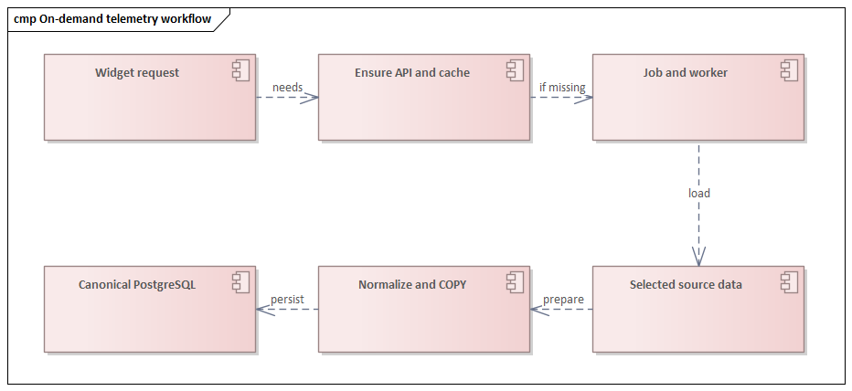

A részletes mintákat a PostgreSQL COPY műveletével átmeneti táblába írom, majd adatbázison belüli művelettel helyezem a végleges táblákba. A rekordok és a készültségi állapot összehangoltan frissülnek. Egy megszakadt írás visszavonható, a kapcsolati és egyediségi szabályok az átviteli módtól függetlenül érvényesek. Az ellenőrzött üres tartomány akkor szabályos, ha a helyzethez ténylegesen nem várható megfigyelés. A szükséges csatornához tartozó üres szolgáltatói válasz külön lefedettségi vagy betöltési hibát ad. [2, 8]

#### 5.1.3. Normalizálás és tiszta körök

A munkamenetből először a résztvevőket rendelem össze. A körök, etapok, időjárási minták és versenyirányítási üzenetek azonos órára kerülnek. Az autó- és pozícióadat a résztvevőhöz, valamint az ismert körhöz és etaphoz tartozik. Utólag hozzáadott telemetriánál ugyanazt a tárolt origót használom. Így egy későbbi részletimport sem tolja el a már megjelenített adatsorokat.

A tisztakör-minősítés ellenőrzi a köridő tartományát, a szektorok teljességét és összegét, illetve a szomszédos körök időfolytonosságát. A szektorösszeg megengedett eltérése három ezredmásodperc, a vizsgált szomszédos körhatáré 750 ezredmásodperc. A bokszhoz kapcsolódó, törölt vagy semlegesített körök külön elutasítási okot kapnak. Ismeretlen pályaállapotnál a modell bizonytalan bemenetként kezeli a kört. A szabályt a forrásrekordok értelmezéséhez választottam, így a minősítés eredménye a verzióval és az indokkal együtt ellenőrizhető. [2, 12]

### 5.2. Történeti visszajátszás

#### 5.2.1. A lejátszás elindítása

A felhasználó a munkamenet megnyitása után elrendezést és pilótákat választ. Ebből áll össze, mely alapadatokra és mely részletes csatornákra van szükség. A lejátszás az induláshoz szükséges adatok elkészültéig le van tiltva. Az adott nézet megnevezi, hogy például az idővonal, a kiválasztás, a pozíciók vagy az első stratégiai állapot hiányzik. Az elemzőpanel közben is mutathatja azokat a már elérhető adatokat, amelyekhez nincs szükség a készülő telemetriára. A mentett választás csak a névsor megérkezése után ellenőrizhető, különben egy átmenetileg üres lista érvényes pilótákat távolítana el.

Az idővonal végpontja a tárolt körök lefedettségéhez igazodik. A böngésző a kezdő és záró időpontból készíti a léptetéshez szükséges rácsot. Az utolsó időpont akkor is szerepel, ha a tartomány hossza nem osztható egyenletesen a lépésközzel. A mintavétel lépését a teljes időintervallum és a megengedett válaszméret határozza meg. Egy korábbi megoldás a teljes sor elejéből adta vissza az engedélyezett számú rekordot. Az API így sikeres választ adott, a lejátszás mégis a futam közepén ért véget. A jelenlegi lekérés az egész tartományt lefedi, egyetlen kör részletes vizsgálatához pedig szűkebb lekérést használ. [3, 4]

#### 5.2.2. Közös idő, eltérő frissítési gyakoriság

A lejátszási pozíciót a kiinduló versenyidő és a monoton böngészőóra különbsége adja. Ha a sebességszorzó k, akkor az új pozíció t = min(t_vég, t_kezdő + k · Δt). A pillanatnyi időből a tárolt mérések közül választ a térkép, a pilótakártya és az időmérő torony. A felületen a visszajátszás 0:00-tól indul, az adatlekérések továbbra is a teljes munkamenet kanonikus óráján dolgoznak. A szüneteltetés és az ugrás ugyanazt a koordinátát írja felül.

A leggyorsabb jel a térkép mozgását szolgálja. A közölt érték játék közben legalább körülbelül 32 ms elteltével frissülhet újra, amit a böngésző képkockáihoz igazítok. A leolvasási jel jellemzően 240 ms-onként frissül, az erre feliratkozó időmérő torony például ritkábban igényel újrarajzolást. Egyes elemzőnézetek ritkábban, körülbelül kétmásodperces ütemben dolgoznak. A stratégiai API a kijelzett időből képzett ötmásodperces versenyidő-ablakhoz ad közös eredményt. A frissítési ütemek korlátok, a tényleges megjelenítés a készülék és a böngésző terhelésétől függ.

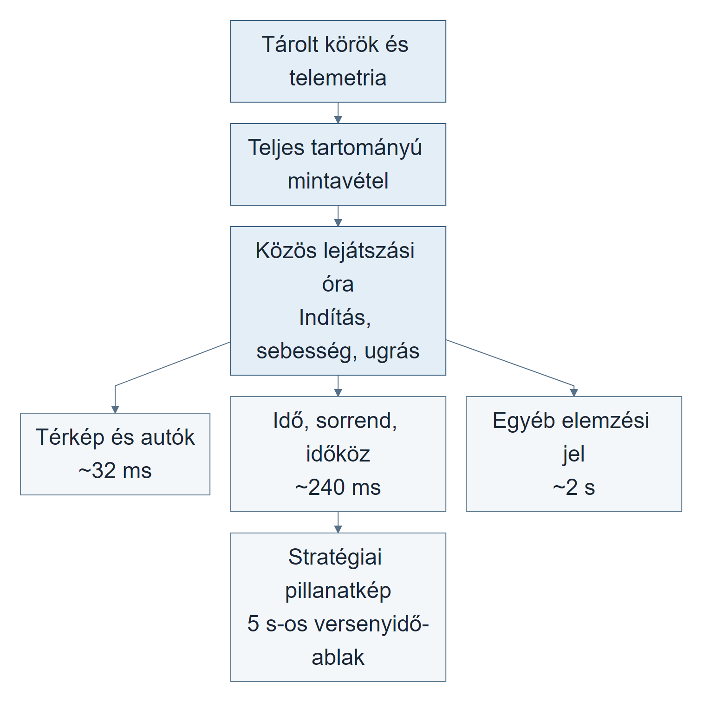

Ugráskor a térkép, a vezérlők kijelzése és az elemzési jel rögtön az új helyre lép. Előrehaladáskor a korábbi, még érvényes stratégiai állapot a saját idejével a panelen maradhat, míg az új válasz megérkezik. Visszatekeréskor a választott ponthoz képest későbbi állapotot elengedem. Így a képernyő nem villan üresre minden frissítésnél, és egy gyors visszaugrás után a később megismert gumicsere vagy zászló sem marad ott. A lejátszás során a különböző paneleknek ezt a szabályt önállóan is fenn kell tartaniuk, például egy rádiórészlet közlésénél vagy a már befejezett etapok számításánál.

#### 5.2.3. Pályatérkép és időmérő torony

A térkép állandó háttere és az autók helyzete külön készül. A helyszín középvonalát, illetve a rendelkezésre álló pályaszélesség-profilt egy teljes referencia-kör pozícióihoz regisztrálom. Ha az illesztés elégtelen, a térkép megfigyelt pályavonalat használ. A mozgást a friss pozícióminták alapján rajzolom, az autókat nem vetítem rá a középvonalra. A pályaszélesség és az oldalirányú helyzet pontosságát a bemenet meghatározza. Megszakadásnál vagy életszerűtlen ugrásnál a rajz nem köt össze távoli pontokat. A bokszutca a térkép része, az ismert kiállások helyzetsorából vagy ismétlődő, alátámasztott ki- és visszatérési útvonalból készülhet. A helyi zászló területét csak illesztett pályaadattal lehet konkrétan színezni.

A Replay Focus nézetben a térkép és a kiválasztott pilóták kártyái mellett a teljes mezőny sorrendje látható. A pilóták száma, a csapatszín és az egymáshoz képest elfoglalt hely a térképet és a táblázatot összeköti. Az időmérő torony a munkaterület része, így a választott panelcsomagtól és a kijelölt pilótáktól függetlenül elérhető. Váltani lehet az éllovas és a közvetlenül előrébb haladó pilóta szerinti rés között. A jelentett adat lejárta után az utolsó közösen megfigyelt körvonal adhat jelölt becslést. A körhátrány körben marad. Időmérőn és edzésen a befejezett legjobb körök jelennek meg.

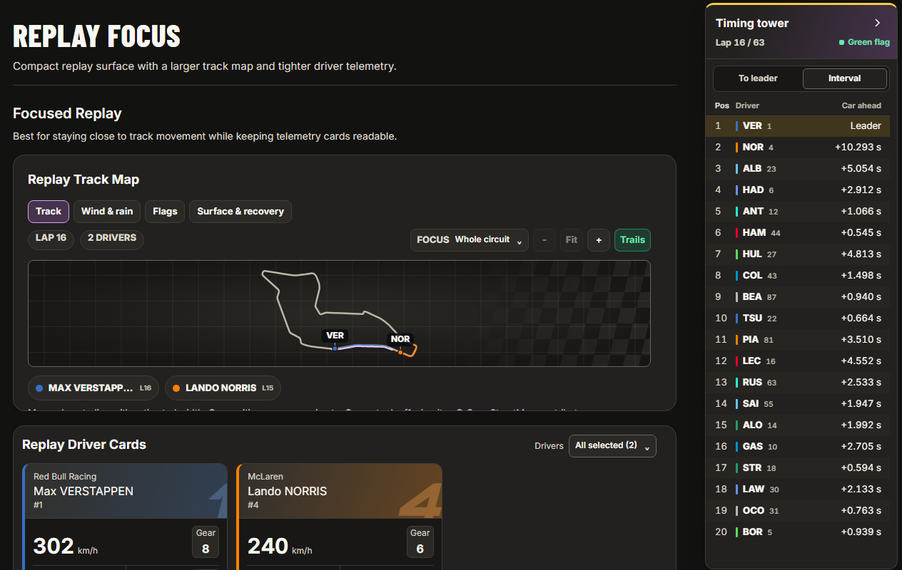

A 16. körben készült képen a pilótakártyán megjelenő pillanatnyi sebesség és az időmérő torony köze különböző forrásütemet követ. A sebesség időben közeli telemetriaminta, az időköz az utolsó elérhető időmérési jelentés. Ugyanahhoz a lejátszási ponthoz érvényesek, a minták ideje mégsem szükségszerűen azonos. A sorrend teljes mezőnyös marad akkor is, ha közben az egyik pilótát kiveszem a térképről. Ez különösen fontos, ha az adott autó mögött haladót keresem, és a rivális nincs a kiválasztott telemetriapilóták között.

### 5.3. A munkaterület és a menthető panelek

A paneltípus meghatározza a bemeneteket, a megengedett munkamenettípusokat és a mérettartományt. Az azonos típusú példányok más pilótát, kört vagy értesítési szűrőt is használhatnak. A gyári összeállításból saját elrendezés készíthető. A mentés a példányok azonosítóit, méretét, pozícióját és beállításait rögzíti a felhasználóhoz. A kliens a rácson már szerkesztés közben jelzi a korlátot. A szerver a nem támogatott panelt, hibás méretet vagy ütköző elhelyezést elutasítja, sikertelen mentésnél a vázlat újból elküldhető. A kedvencek előresorolhatók a választónál. [7]

Edzésen a hosszú etapok és a fékezés értelmezése kerülhet előtérbe. Időmérőn a befejezett körök és a szektorok azonos referenciához viszonyíthatók. A száraz versenytávra és időjárási gumiváltásra vonatkozó automatikus stratégia a nagydíj visszajátszásában érhető el. Ez azért követelmény, mert más típusú munkamenetben hiányozhat a versenytáv, a riválisok jelentése vagy a kiállás szabályos célja. Az összeállítás kompatibilitását ezért a szerkesztőben és megnyitáskor is ellenőrzöm.

### 5.4. Stratégiai számítás és forgatókönyv

#### 5.4.1. A döntési pillanatkép és a számítások eredete

A stratégiai szolgáltatás minden kérése kijelöl egy felső időhatárt. A köridő csak a befejezett körhöz, a részidő pedig az addig megtörtént szektorátlépéshez társítható. A tárolt időjárást, pozíciókat, kiállásokat és versenyirányítási jelzéseket ugyanez a határ szűri. Az új gumikeverék is csak akkor használható, ha az adott pillanatban elérhető bokszjelentés vagy bokszkijárati megfigyelés támogatja. Az aktuális futam végső befutója és a ténylegesen teljesített versenytáv kimarad a tervekből. A tervezési táv a közzétett programból származik.

A korábbi edzések csak befejezett és hozzáférhető állapotban kerülnek a bemenetbe. Előnyt élvez az azonos hétvége hosszú etapja és a korábbi, azonos pályán rendezett futam. Egy konfigurált vizsgálat saját pályageometriát vagy modellparamétert is kaphat. Az alkalmazás a tárolt eseményidőt és a hozzá tartozó megfigyelési határt használja. A nyilvános adatok utólagos korrekciójának teljes beérkezési előzménye hiányzik, ezért ez az eljárás történeti döntési helyzetet közelít. [5, 6, 12]

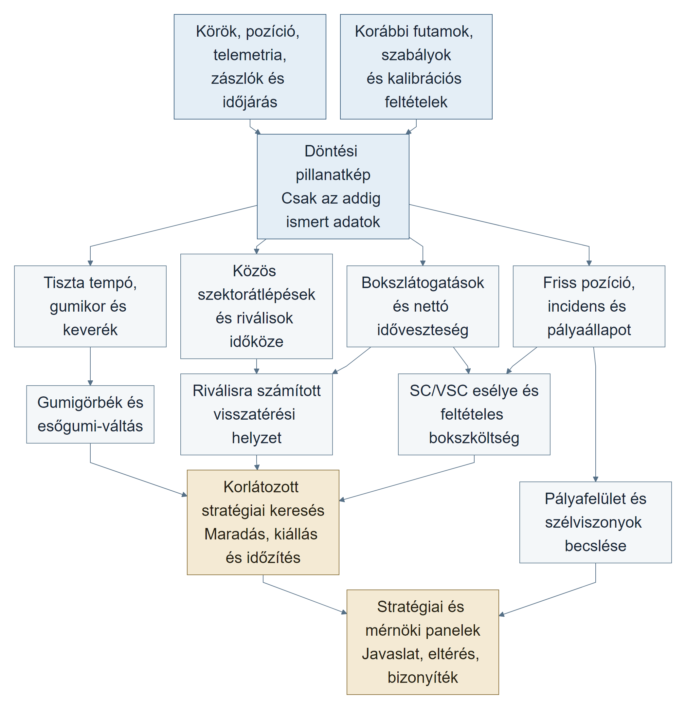

A mérőszám értéke mellett az egység, a számítás időhatára, a minta mérete és az eredet is elérhető. A rendszer a jelentett adatot, a levezetett értéket, a becslést és a feltevést külön jelöli. Az időköz például két megismert időbélyeg különbsége lehet. A riválissal várható találkozás ehhez képest előrejelzés. Egy várható eső kezdete a felhasználó által megadott feltétel. Ha a szükséges bemenet hiányzik, a kimenet elérhetetlenséget ad, amiből a panel az okot is meg tudja jeleníteni.

#### 5.4.2. Tempó, gumidegradáció és hátralévő táv

Az összehasonlítás alapja a megfelelő körök mediánja. Ha a köridők halmaza L, akkor a középérték m = medián(L), a robusztus szóródási becslés pedig MAD = medián(|l_i − m|). Egy kiugróan lassú kör így kevésbé torzítja a jellemző tempót. Két egymást követő körablak mediánjának eltérése megmutatja az irányt, a változás okát viszont más adatokkal kell vizsgálni. Az összehasonlított körök és az esetleges korrekciók az eredményhez tartoznak. [5, 6]

A száraz előrejelzés a gumi korához tartozó köridő-változást a páronkénti meredekségek mediánjával becsüli. Egy hosszú etaphoz legalább öt egymást követő megfelelő száraz kör szükséges az első két gumikör kihagyása után. A nagy maradékhibájú pontokat az illesztés kiszűri, majd új meredekséget számol. A különböző keverékek kezdeti tempóját azonos pilótán és munkameneten belül hasonló gumikornál veti össze. A gyorsabban futott alaphoz képest három százalékot meghaladó különbség esetén az összevetés kieshet, mert a különböző üzemanyag, üzemmód vagy az edzés feladata könnyen nagyobb eltérést okozhat a guminál.

Ha a becsült alapköridő b másodperc, a gumikor a, az egy környivel idősebb szetthez tartozó időbüntetés pedig d másodperc, egy további n körös etap költsége n·b + d·[n·a + n·(n+1)/2]. A képlet a következő körök egyre nagyobb gumikorát összegzi. A tervezés az életkortól függő büntetést nullánál határolja, miközben a felületen a megfigyelt negatív meredekség is látható. A modell a megfigyelt tiszta tartományból dolgozik, az azon túli folytatást külön jelöli. A megfigyelt 17 kör ezért tapasztalati határ, amely eltér a gyártó által megadott fizikai határtól vagy az adott hétvége előírásától.

A jelenlegi szett eltérő tempóját a közelmúlt megfelelő körei korrigálhatják. Tartós romlás csak akkor módosítja az előrejelzést, ha az egymást követő maradékok a korábbi szóródáshoz képest is nagyok. A fékezés közbeni sebességplató kiegészítő eseménybizonyíték. Az időbüntetés alapja a később mért tempó, amelyet a forgalom, sérülés, hőmérséklet vagy a gumi állapota is befolyásolhat.

A gumikor és a verseny előrehaladása egy etapban általában együtt nő. Az üzemanyag tömegének csökkenéséhez tartozó hatás önmagában ezért nehezen választható le a gumi hatásáról. A beállítható forgatókönyvben a körönkénti fogyasztás és a tömegérzékenység szorzata külön összetevő. A beállított érték például 1,5 kg/kör és 0,03 s/kg mellett 0,045 s körönkénti javulást jelent. A konfigurálható illesztés rang- és kondícióvizsgálata az azonosíthatatlanságot is jelezheti. Ez megakadályozza, hogy az egymással túl szorosan együtt változó bemenetekből biztos fizikai hatást állapítsak meg. [6, 18]

#### 5.4.3. A kiállás tényleges vesztesége és a riválisok

A szerelés ideje, a bokszutcában eltöltött idő és a nettó versenyidő-veszteség három eltérő mennyiség. Az utolsóhoz a kiálló pilóta bevezető körének harmadik szektorát és kivezető körének első szektorát összeadom, majd levonom a kiállás nélkül, hasonló időben haladó pilóták megfelelő részidejeinek mediánját. Az összehasonlításhoz legalább három külön referencia szükséges. A kiállási jelentésnek illeszkednie kell a mért körhöz, a versenyfázisnak pedig a teljes mérési ablakban ismertnek és azonosnak kell lennie. A zöld zászlós és semlegesített minták külön kerülnek a becslésbe.

Ha az adott futamban kevés az összevethető kiállás, azonos pályáról korábbi mérés vagy egész körös viszonyítás használható. A szektoros, illetve egész körös számítás nem fedi le ugyanazt az időszakot. A kivezető kör betanult melegedési veszteségét ezért csak a szektoros bokszbecsléshez adom hozzá. A becslésnél feltüntetem a kiválasztott módszert és a mintaszámot. A régebbi pályaelrendezés átvitele külön bizonytalanságot ad.

A pillanatnyi riválist a pályán mért rés és az összevethető tempó alapján rangsorolom. A megvalósított súlyozás 56 százalékot ad a jelenlegi vagy kiállás előtti közelségnek, 31 százalékot az egyező körök tempójának, 9 százalékot a futam előtti bajnoki közelségnek és 4 százalékot a rajtsorrendnek. Ezek rangsorolási súlyok. Egy közelmúltbeli, legfeljebb nyolcmásodperces kiállás előtti rés hatása az idő múlásával csökken. Így egy éppen kiállt, átmenetileg hátrébb lévő pilóta megmaradhat releváns ellenfélnek, miközben egy rajtbüntetés kevésbé befolyásolja a besorolást.

A két versenyző közös szektorátlépései ugyanazon pályaponthoz tartozó időkülönbséget adnak. A különbséget csak mindkét mérés megjelenése után használom. A körönkénti előrejelzés g_következő = g + p_saját + c_saját + f − p_rivális − c_rivális alakú. A p a becsült köridő, c a körben felmerülő kiállási veszteség, f a támogatott követési többlet. Pozitív g esetén a vizsgált versenyző a rivális mögött halad. A friss megfigyelt időközt használom kezdőpontnak, a már eltelt lassú kivezető szektort így nem vonom le másodszor. A megmaradó veszteség a következő megfigyeléskor újrabecsülhető.

A rivális esetében külön ág a pályán maradás, az azonnali kiállás és az érvényes jelenlegi szetten történő célba érkezés. Egy szokatlanul lassú kiállásnál a modell két esetet vet össze. Az egyik a közölt bokszadattal számol, a másik a rivális veszteségét a szokásos értékre állítja vissza. Ha a két visszatérési állapot előjele és nagysága az ingadozást figyelembe véve is eltér, a kiállás új lehetőséget nyithat. A becslés a többi pilóta helyzetét az adott összevetésben rögzíti, így az eredmény a feltételezett riváliságra érvényes.

#### 5.4.4. Incidensek és a várható bokszköltség

A rendszer az eseményjelzésnél először az addig ismert versenyirányítási megfigyeléseket használja. Friss sebesség- és pozícióadat jelezhet gyanús lassulást vagy megállást. A puszta telemetriajelölt nem indít százalékos előrejelzést. Ha ismert a megfelelő pályafelület és a mentési kijáratok helye, a felület és a kijárattól mért távolság felhasználható. Külön geometriai adat hiányában az állapot ismeretlen. Egy lassulás önmagában fékezési hibát, elengedést vagy műszaki gondot is jelenthet.

A statisztikai előrejelzés a korábbi futamok hasonló incidenseit az akkor már eltelt időnél hasonlítja össze. A következő 120 másodperc első kimenetele lehet biztonsági autó, virtuális biztonsági autó, piros zászló vagy beavatkozás nélküli lezárás. A modell a hasonló kohorsz számait és az általánosabb történeti gyakoriságot egyesíti. Egy kategória becslése p = (n + 0,5 + 60·p_pool) / (N + 62), ahol n a kategóriába eső esetek száma, N az összevethető incidensek száma, p_pool az összes korábbi mintából számolt gyakoriság azonos időfeltétellel. A regularizáció célja, hogy néhány történeti eset ne adjon szélsőséges becslést. A mellékelt tartomány a minta korlátját jelzi.

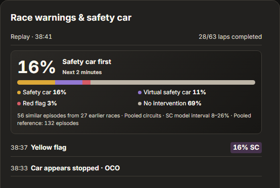

A kiállási döntéshez a későbbi időpont számít, amikor az autó a bokszbejárathoz ér. Egy addigra véget ért virtuális biztonsági autó már nem csökkenti a kiállás költségét. Összegzem az egyes első kimenetek valószínűségét a fázis érkezéskori fennmaradásának feltételes valószínűségével súlyozva. A várható nettó veszteség az ismert zöld bokszköltségből indul. Ebből levonom a becsült SC- és VSC-kedvezményt, mindkettőt a várható belépéskor fennálló fázis esélyével szorozva. A már közölt fázis átveszi az előrejelzés helyét, a bejárat lezárása pedig kizárja az azonnali kiállást.

#### 5.4.5. Tervkeresés és a felületen olvasható eredmény

A száraz tervkeresés a hátralévő körökhöz, az aktuális szett állapotához, a már használt keverékekhez és a becsült kiállási időhöz rendeli a folytatás költségét. Minden megengedett első kiállási körre és keverékre dinamikus programozással megkeresi az elérhető legkisebb becsült hátralévő időt. Az automatikus nagydíjmodell legfeljebb három kiállással számol. A szabályok az adott futam szerint korlátozhatják a keverékeket, a szettek számát és a gumikkal teljesíthető köröket. A készletet a nyilvános adatokból csak részben lehet ismerni, a modell friss szettek elérhetőségét feltételezi. [6, 25]

A közeli eredményű első kiállások egy bokszablakba kerülhetnek. Ezért az ajánlás mellett szerepel az alternatíva és a hozzá képest számolt előny. Egy 1,1 másodperces előny a hátralévő teljes távra csekély lehet, különösen, ha a bokszveszteség bizonytalansága ezt meghaladja. A kijelzett százalék a hátralévő modellidőhöz mért arány. Ez eltér a biztonsági autó eseményvalószínűségétől, ezért más névvel és eltérő vizuális formában jelenik meg.

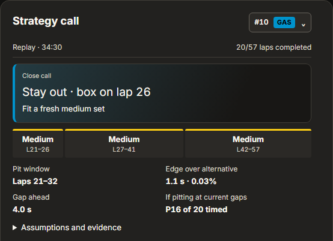

A panel a számított tervet felhasználói döntési helyzetként mutatja be. Az egyes keverékekhez tartozó etapokat időrendben helyezi egymás mellé, a bizonyíték és a modellfeltevések külön nyithatók meg. Az incidens, az időjárási váltás és a rivális összevetése ugyanabból az időpontból indul. Az ajánlás értelme így egy korábbi pillanatra visszatérve is ellenőrizhető.

A tervkeresést egy rövid, szemléltető esetben a kiállás utáni időközből lehet követni. Ha egy versenyző 5,0 másodperccel van a riválisa mögött, a saját nettó bokszvesztesége 21,0 s, a rivális pedig ugyanabban a körben 23,5 másodpercet veszít, a szereléshez és a bokszutcához kötött változás 2,5 másodpercet hoz vissza az ötmásodperces hátrányból. A még hátralévő köridők külön hatnak. Az új szett első körében 0,7 s melegedési veszteség mellett 3,2 másodperces hátrány adódik, ha egyébként azonos a tempó. Ha a következő három körben a frissebb szett körönként 1,3 másodperc előnyt ad, a modell végül 0,7 másodperces előnyt jelez. Azonos saját kiállásnál, a rivális szokásos 21,0 másodperces kiállását feltételezve a becsült előny előjele megváltozik. A példaszámok szemléltetik a műveletek sorrendjét, futamhelyzetben az előjelváltást a mért szóródással együtt értékelem.

A vetített pozíció az időnyereséghez képest további szempont. A gyorsabb terv visszatérhet olyan autók mögé, amelyek mellett a modell csak gumi- és tempóelőnyt tud jelezni. Az előzés sikeréhez külön pályahelyzet, forgalom és manőver kellene. A megjelenített visszatérési hely ezért a többi versenyzőt rögzített helyzetben tartó összehasonlítás. Az egykörös időzítési döntéshez így külön látható a becsült visszatérés, a néhány körre számított tempóelőny és a célig számított különbség.

#### 5.4.6. Kivezető kör, eső és száradó pálya

A gumicsere utáni kivezető kör elején a bokszkijárat lassítja az első szektort, a hideg gumi pedig a következő szakaszokat is. A szektor ideje az átlépés és egy másodperces közzétételi tartalék után használható. A kivezető kör első szektora kimarad a tempómintából. A második szektorból már a kör befejezése előtt becsülhető, hogy milyen irányba változik az ellenfél tempója. A modell azonos keveréken melegedett autókkal, vagy már megfigyelhető következő saját körrel veti össze a hideg szett időveszteségét. Ha a bokszköltség a bejárati és kijárati szektorból készült, a további melegedési költség egyszer kerül rá az új szettre. Egész körös becslésben benne lehet ugyanez a veszteség.

Változó időben a rendszer a teljes mezőny slick, intermediate és teljes esőgumis részidejeit nézi. Időben közeli, azonos szektoron áthaladó autókat párosít, figyelembe véve a pilóta szokásos szektortempóját és a mérhető melegedési különbséget. Bejelentett esőnél a régi szektorok hamarabb válnak alkalmatlanná, így a száraz pálya mintái kisebb eséllyel fedik el a tapadás romlását. Elegendő összevethető autó mellett az eltérő száraz keverékek külön vizsgálhatók. A kérdés itt rövid távú, legfeljebb öt körre szól. A program összeveti az azonnali váltást, az egy körrel későbbi váltást és a pályán maradást.

Az első váltó előtt megadott esőforgatókönyv a közölt kezdési és befejezési időt, intenzitást, valamint valószínűséget használja. A szektoros bizonyítékot korábbi, a döntési időpont előtt már lezárt futamok azonos körülményeivel kombinálja. A várható javulás az esővel érintett körszakasz arányától is függ. A tényleges OpenF1-adat megfigyelt, pályaszintű csapadékjelzést ad. A jövőbeli esőt külön bemenetből kell megadni. Amikor még kevés a minta, vagy az egyetlen szektor előnye nem fedezi a kiállás költségét, a kimenet további szektorok figyelését javasolhatja. [6, 12]

#### 5.4.7. Fizikai kiegészítések és a bizonyíték határa

A követési távolság közelítéséhez a friss időköz és a sebesség szorzata használható. A 0,4 s rés 80 km/h-nál mintegy 8,9 méter, 250 km/h-nál 27,8 méter. Azonos időközből tehát különböző pályaszakaszokon eltérő fizikai közelség következik. Az útvonal menti távolsághoz további helyzet- és pályabizonyíték kell. Egy közel futó, de a hajtű másik ágán haladó autó így nem lesz automatikusan követett rivális.

A légáramlási forgatókönyv a sebesség, a követési távolság és egy kalibrációs feltevés alapján becsli a lehetséges terhelést. A követésből adódó leszorítóerő-érzékenység fizikai támpont, a később mért köridőromlás mögött több hatás állhat. A szél hossz- és keresztirányú összetevőjéhez illesztett földrajzi irány és friss autóirány szükséges. Enélkül légsebességtartományt lehet közölni. A dinamikus nyomás számítható a légsűrűségből és a relatív sebességből, a közvetlen köridőveszteséghez viszont további kalibráció kell. [12, 16-18]

A modell a gumi lehetséges terhelésváltozását indexben jelzi, a nyilvános adatokból a gumihőmérséklet és a valódi kopás nem mérhető meg. Az erős lassulással járó esemény és a kerékblokkolás közé szintén nem tehető egyenlőségjel. A fékjel és a teljes jármű sebessége alapján a lassulás és a fajlagos mozgásienergia-változás számítható. Kerékre vonatkozó állításhoz többletmérés kell. A felületen az eseményjelölt, a jelentett megfigyelés és az ezekből számított valószínűség eltérő címkét kap. [12, 19]

## 6. Tesztelés és értékelés

### 6.1. A próbák és a követelmények kapcsolata

A képletet determinisztikus, kézzel ellenőrizhető próbával vizsgálom. Az API- és adatbázistesztek az idegen azonosító, a tranzakció és a párhuzamos kérés eseteit fedik le. A böngészőben több műveletet kell egymás után elvégezni, mert az alapimport, a mentett nézet és az idővonal külön hibátlanul működhet úgy is, hogy a felhasználói folyamat közben még megszakad. A rögzített versenyeseteknél a minta és a kezdőállapot az értékelés része.

| Követelmény | Vizsgálat | Eredmény vagy nyitott pont |
| --- | --- | --- |
| F01, NF04 | Profilmentés, jogosultság, idegen azonosító | A vizsgált kérésekben a szerver helyesen különíti el a fiókokat. |
| F02, F09 | Katalógusazonosság, hibás vagy jövőbeli munkamenet, adatkészültség | A forrás- és böngészőpróbák igazolják. A jövőbeli eset helyettesített katalógust használt. |
| F03, NF02, NF05 | Valódi OpenF1-import, worker, párhuzamos igény, ismételt előkészítés | A kiválasztott adatrész tárolható és újrahasználható. |
| F04-F05, NF03 | Teljes idővonal, visszatekerés, zászló, rádió, sorrend | Az ellenőrzött panelek a választott időpontra állnak vissza. |
| F06, NF06 | Saját elrendezés mentése, kompatibilitás, keskeny kijelző | Mentés és visszatöltés ellenőrzött, a tornyot külön lehet megnyitni. |
| F07 | Számértékek, egységek, hiányos forrás | A tesztelt értékek és állapotok megfelelnek a szerződésnek. |
| F08 | Későbbi bemenetek változtatása, tervkeresés, tényleges történeti fordulópontok | Időkorlát és támogatott tervágak ellenőrizve. A valós döntés általános pontossága további vizsgálat tárgya. |
| NF01 | Előkészítési és indulási idő rögzített kezdeti állapotban | Három pilótán igazolt. A teljes mezőnyre a végleges adatúton külön mérés szükséges. |
| NF07 | Numerikus, API-, adatbázisos és felületi regresszió | A vizsgált helyi tesztkör működik. Többfelhasználós terhelésről nincs mérés. |
| F10-F12 | Forrásolt MI-válasz, fizetési állapot és tartalomfrissítés | A teljes folyamat a tervezett fejlesztésekhez tartozik. |

A numerikus próbákban kézzel számítható szektorkülönbségeket, sebességből levezetett mennyiségeket és hiányzó adatokat használok. Az időbeli ellenőrzéshez a döntési határ utáni bemeneteket megváltoztatom, majd ugyanarra a korábbi időpontra újraszámolok. A tervkeresést kis, függetlenül felsorolható esettel hasonlítom össze. Az adatbázisos próbák elkülönített PostgreSQL-sémában futnak, és a rekordírás mellett a tranzakció visszavonását és az egymással versengő igényeket is ellenőrzik. [4-6]

A legutóbbi dokumentált termékellenőrzés 212 backend- és 65 frontendteszt sikeres eredményét rögzítette. A backend összesítésében a sémamigrációs vizsgálat külön futtatási körbe tartozik. A frontend lint, típusellenőrzés és produkciós build is sikeres volt. A build méretfigyelmeztetése megmaradt. A tesztek száma a regressziós kör terjedelmét jellemzi, a forrás teljes versenynaptárra kiterjedő lefedettsége külön kérdés. [4]

### 6.2. Betöltési idők és valódi OpenF1-adatút

A részletes adatút próbájához a 2025-ös Ausztrál Nagydíj három pilótáját választottam. Az alapimport a futam névsorát és köreit készítette elő. A telemetria-előkészítés a kiválasztott csoportból 233 940 autó- és pozíciórekordot tárolt. A teljes alapimport minősítése 470 tiszta kört adott. A kész tartomány újbóli kérése kész válasszal tért vissza. A vizsgált stratégiai válasz 256 értéke közül 74 volt elérhető. A többihez a jelen próba adatai alapján hiányzott valamely szükséges bemenet. [4]

| Mérési helyzet | Idő | Feltétel |
| --- | --- | --- |
| Közvetlen telemetria-előkészítés | 17,601 s | Három pilóta, új adatbázisséma, meglévő forráscache, párhuzamos tesztfuttatás. |
| Megismételt közvetlen próba az elkülönített HTTP-klienssel | 18,714 s | Ugyanaz a futam és csoport, új séma, meglévő forráscache. |
| Első dokumentált böngészős visszajátszási indulás | 50,583 s | Ugyanennek a futamnak három pilótája, a felhasználói előkészítési folyamattal együtt. |
| Későbbi böngészős regresszió | 3,885 s | Három pilóta megnyitása a már importált munkamenetből. A próba az adatokra várakozást és az indítás tiltását is vizsgálta. |

Az első két próba új sémából és már letöltött forrásválaszokból indult. A későbbi böngészős regresszió órája a munkamenet alapimportja után indult, az adatbázisban meglévő részletes minták állapotát nem rögzítette külön. Teljesen új, hálózatról induló lekéréshez a szolgáltatói válaszidő és a kérések ütemezése is hozzátartozik. A 180 másodperces cél teljes mezőnyös igazolásához azonos feltételeket és azonos pilótaszámot kell beállítani a végleges OpenF1-adatúton. A történeti fejlesztési mérések a függelékben követhetők.

### 6.3. Stratégiai esettanulmányok

A korabeli versenybeszámoló vagy a hivatalos kiállási jelentés meghatározza az ellenőrzött eseményt. A modell csak az adott időhatárig hozzáférhető adatokon számol. A tényleges verseny későbbi eseményeit az értékeléshez használom fel, például annak ellenőrzésére, hogy a kiállás ekkor megtörtént-e, vagy mikor zárták le a bejáratot. Így külön értékelhető a kijelzés ideje, a becslés iránya és a választott feltételezés. [6, 12, 26-29]

| Történeti eset | Ellenőrzött eredmény | Mit mér a próba? |
| --- | --- | --- |
| Bahreini Nagydíj, 2025 | Verstappen kivezető körének második szektora 22,841 s-mal a kör vége előtt volt használható. | A friss szektor időelőnye a teljes körhöz képest. |
| Brit Nagydíj, 2024 | Hamilton kivezető körében a második szektor 24,163 s-mal előbb volt használható. | A száraz gumi vizsgálata megkezdhető az egész kör előtt. |
| Ausztrál Nagydíj, 2025 | A modell 49,711 s-mal a közölt bokszidőpont előtt az intermediate-re váltást javasolta. | A teljes közölt bokszutcai idő levonása után 30,990 s maradt a becsült legkorábbi belépésig. |
| Kanadai Nagydíj, 2024 | A két teljes esőgumis Haas szektorai összevethetők voltak az intermediate-en haladók szektoraival. | Az esős mezőnyösszevetés figyelembe veszi a más csapatoktól származó mintákat. |
| Emilia Romagna-i Nagydíj, 2025 | A visszajátszásban a közölt VSC átvette az előzetes valószínűség helyét. | A panel és a döntési modell az aktuális versenyfázist követi. |
| Ausztrál Nagydíj, 2026 | A rövid ideig lezárt bokszbejáratnál az azonnali kiállás kiesett. | A szabályozott hozzáférés a kedvezőnek látszó tervet is kizárhatja. |

A szektoros időelőnybe az egy másodperces közzétételi tartalék már beleszámít. A böngészős stratégiai frissítés az ötmásodperces versenyidő-ablak miatt késhet a nyers szektorméréshez képest. Melbourne-ben az időelőny a forrás időbélyegére és a becsült bejárati időpontra vonatkozik. A kísérlet 20 másodperces zöld bokszköltséggel számolt. Ez esettanulmány, amely megmutatja, hogy az ajánlás a kiállás előtti mintákból előállítható. A kontrafaktuális terv tényleges befutója ebben a helyzetben nem megfigyelhető.

Silverstone-ban az első összevethető második szektor a slickek javára 0,367 másodpercet adott. Ez a több mint két másodperces bizonytalansági sávhoz és a becsült kiállási költséghez képest kevés volt. A panel újabb szektorok megfigyelését kérte. A további minták alapján már elkülönült a száraz köpenyek előnye. A mérés és a képernyőkép két eltérő próbából származik. A rendelkezésre álló pilótakörök és az adott időponthoz tartozó részidők különbsége miatt pontosan azonos kijelzett különbséget nem vártam. [6, 27]

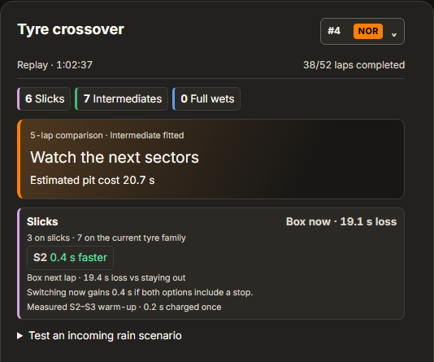

### 6.4. Időrendi visszateszt és a becslés korlátai

A biztonsági autóra épülő becslést időrendben értékeltem. Az archívum 89 futam 352 incidensét tartalmazta. A nyitáskor rendelkezésre álló bizonyítékot felhasználó próbában 290 esetnél állt rendelkezésre megfelelő követés. Ezekből 41 esetben a következő 120 másodperc első beavatkozása biztonsági autó volt. A Brier-pontszám egy bináris kimenetnél a becsült valószínűség és a tényleges 0 vagy 1 érték eltérésének négyzetes átlaga. Kezdéskor a regularizált modell pontszáma 0,12193, az összesített történeti alapé 0,12258 volt. Harminc másodpercnél a viszonyítás értéke 0,08079, a modellé 0,08332. A kis eltérés iránya tehát változott. [6]

Imolában a teszt idején a következő két perc első beavatkozására kapott eloszlás 15,83% biztonsági autó, 11,48% virtuális biztonsági autó, 3,45% piros zászló és 69,24% beavatkozás nélküli kimenet volt. A kijelzett 16% a biztonsági autó kerekített becslése. Ehhez 56 hasonló eset állt rendelkezésre 27 korábbi futamból, a becsült tartomány pedig körülbelül 8% és 26% közé esett. A felhasználó így ugyanabban a nézetben láthatja, mekkora mintából adódott a becslés, és hogy melyik időszakra vonatkozik az érték. Amikor a versenyirányítás valóban VSC-t közölt, a szimuláció a friss jelzést használta. Az előzetes százalék az adott pillanatban egymást kizáró első beavatkozások között oszlott meg. A későbbi VSC egy megfigyelt kimenet ezek közül, amely egyetlen futamon is megtörténhetett alacsonyabb becslés mellett. [6]

A bokszidő visszatesztjében mindhárom módszer ugyanabból a célfutamban mért zöld zászlós költségből indult. A korábbi futamokból tanult módosítás 22 biztonsági autós esetben 2,769 s átlagos abszolút hibát adott a változatlan zöld költséggel kapott 5,405 s helyett. Nyolc VSC-esetben 2,716 s és 7,248 s adódott. Az összevont történeti viszonyítás 2,843 s, illetve 2,750 s hibát ért el. A nagy különbség tehát az állandó zöld modellhez képest látszik, az egyszerű történeti viszonyításhoz mért javulás kisebb. A próba csak olyan futamokra értékelhető, amelyekből az összevethető költség rendelkezésre áll. [6]

A kétpilótás különbségre készített, különálló Miami-vizsgálatban az előző öt közös kör tempója és az utolsó rés alapján becsültem a következő közös kör időközét. Az 52 ponton mért 1,298 s átlagos abszolút hiba kisebb lett a változatlan résből számított 1,640 s-nál. A zavartalan, kiállás nélküli részhalmaz 45 pontján 0,386 s és 0,706 s adódott. Ez a vizsgálat egyetlen pilótapárra vonatkozik, a későbbi zászlóadat a kiértékeléshez tartozott. [6]

A felületi tesztek lefedik a közös stratégiai adat lekérését, az eltérő munkamenetekhez tartozó korlátozásokat és a visszatekerést. Az időmérő tornyot 20 pilótás nagydíjon, 22 pilótás sprinten, továbbá időmérőn és edzésen ellenőriztem. A torony léptetés közben a már lekért időrendi adatokból dolgozik. A sprintpróbában a jelentett időközök hiányában a közös mérési vonalon számolt érték jelent meg. Az eredmény nem fedte el a hiányzó forrást. [4]

A későbbi élő próba külön naplót igényelne az esemény idejéről, a beérkezés idejéről és a javításokról. Egy archív rekord időbélyege megmutatja, mikor történt a megfigyelt esemény. Azt nem rögzíti minden esetben, hogy a teljes rekord a futam közben mikor és milyen formában volt először elérhető. Különösen a körök utólag javított minősítése okozhat eltérést az archív döntési helyzet és egy valódi élő lekérés között. A mostani próbák az ismert időbélyegek szerint visszaállított bemenetekre érvényesek.

A következő fizikai ellenőrzéshez olyan megfigyelés szükséges, amely a képernyőn eseményjelöltként megjelenő helyzetet függetlenül is azonosítja. Gyors lassulásnál például az alkalmazás számára két eset hasonló lehet, ha az autó rövid idő alatt megállt. Ha csak az egyik helyzet jár valódi pályaelhagyással, ennek megkülönböztetéséhez pontos pályahatár vagy versenyirányítási jelentés kell. Érdemes ezért a hiányos eseteket külön csoportba sorolni, és olyan vizsgálatot végezni, amely a találatok mellett a téves és a kihagyott jelzéseket is számolja.

## 7. Fejlesztési tapasztalatok

### 7.1. Az adatforrás megváltozása

Az első alkalmazást FastF1-adatbetöltésre terveztem. Ehhez igazodott a munkamenet kiválasztása, a háttérimport, az adattárolás és az első visszajátszó felület. A forráskönyvtár objektumai az adapter határán maradtak. A felület és az elemzők már ekkor a saját, normalizált adatokra épültek.

A 2026. november 5-i hibakereséskor a korábban tárolt körök és etapok megnyíltak, az új autó- és pozícióadat letöltése viszont több futamon hitelesítési hibába ütközött. A FastF1 v3.9.0 kiadásleírása szerint az F1-adatarchívumhoz F1 TV Access vagy magasabb előfizetéshez tartozó hitelesítés kellett. A szolgáltatói követelmény változott, a könyvtár frissítése ezt kezelte. A tárolt körök működése elfedte az adatútnak azt a részét, amely már új engedélyt kért. [11]

A két szolgáltatót egyesítő hibrid változatban az OpenF1 adta volna a történeti belépőszintet. Az előfizetett F1-fiókkal rendelkező felhasználó külön kapcsolhatta volna a saját hozzáférését. Ehhez a kapcsolati állapot, a lejárat, a jogosultság és a felhasználói titok kezelése is tartozott volna. A duplikáció elkerülésére egy importált adathalmazhoz egy szolgáltatót rendeltem volna. Ez a szabály azért volt szükséges, mert két forrás azonos nevű mezői vagy időbélyegei eltérő jelentéssel bírhatnak. [13, 14]

A FastF1 natív belépést is kínált. A vizsgált, hivatalos F1-oldalas böngészős átadáshoz a FastF1 Companion kiegészítő kellett. A külön telepítés, a token átadása és a külső fiókhoz tartozó hibakezelés több lépést tett volna egy futam egyszerű megnyitásához. A natív belépés valós, előfizetett fiókkal történő ellenőrzése szintén külön fejlesztési feladat maradt. A határidő mellett ezért egyetlen aktív, végigtesztelhető történeti adatút mellett döntöttem. [11, 15]

Az OpenF1-váltásnál az adapter, az azonosítók kezelése és az adatok minősítése változott. A belső modellre épülő tárolás, a lejátszási koordináta és a személyes nézetek megmaradhattak. A hiányzó feldolgozott mezőkhöz ott készítettem saját számítást, ahol a bemenet alátámasztotta. Ennek példája a tisztakör-szűrés és az azonos időmérési pontból levezetett rés. Az OpenF1 2023-tól ad történeti adatokat. A dokumentált próbák elsődleges tartománya 2023-2025, amit néhány célzott 2026-os eset egészít ki. Ez a korábbi archívumnál szűkebb történeti kiindulást jelent. [12]

### 7.2. A visszajátszás fejlesztési tanulságai

Az első teljes betöltés minden részletes csatornán végigment akkor is, ha a felhasználó később csak két autót választott. Ezt az alapadat és a részletes csatornák szétválasztása oldotta fel. A háttérmunkára áttérés követhetővé tette a várakozást. A tényleges feldolgozási költséget az csökkentette, hogy a kiválasztás már a forrásnál és az átalakításnál érvényesült, a kész adatrész újrahasználható lett, és a nagy írás a COPY műveletre került. Egy korai, pontos időnapló nélküli próbánál tizenöt perc alatt sem jutottam el működő visszajátszásig. Ezt megfigyelésként kezeltem, az összehasonlítható mérések külön készültek.

A visszajátszásnál a sikeres HTTP-válasz mögötti adatok időtartamát is ellenőrizni kellett. A későbbi rész hiányát a teljes tartományra méretezett mintavétel és a pontos végpont együtt szüntette meg. Más hibát okozott, amikor a be nem töltött névsort a rendszer üresnek tekintette, és elfelejtette a kiválasztást. Az ellenőrzési időzítés változtatásával megmaradt a felhasználó választása és az eredeti, szűk adatkérelem. Ezeket a hibákat a teljes böngészős műveletsor mutatta meg.

### 7.3. A felület olvashatósága

Az első egységes panelstílusban a bonyolultabb számítások egymáshoz hasonló számkártyákba kerültek. Egy stratégiai helyzetnél így nehéz volt megállapítani, melyik szám vonatkozik időre, melyik esélyre, és miért változott meg a javaslat. A későbbi változatban a gumietapok és a lehetséges kiállási ablak időrendi ábrán jelenik meg. A térképen és a sorrendben az autóhoz tartozó csapatszín segíti a követést. A magyarázatokból a döntéshez szükséges rövid felirat maradt az első nézetben, az összetettebb bemenetek külön nyithatók meg.

A munkaterület világos és sötét témája közös elrendezést használ. A panelmagasság a frissítés alatt megmarad, így új számítás érkezésekor a felület nem mozdul el. Széles képernyőn a teljes mezőny táblázata a panelek mellett marad, kisebb eszközön külön, a képernyő aljáról nyitható. A színsáv és az elrendezés elsődleges célja a gyors olvashatóság, a kulcsinformáció szövegben is elérhető. Az ellenőrzéshez a térképes futamnézetet, a torony görgetését és a táblázat mobilos megnyitását is végigjártam. [4]

## 8. Összefoglalás

### 8.1. Elkészült eredmények

A PitWall Insights működő történeti adatutat kapcsol össze az igény szerint előkészített telemetriával és a közös órán futó visszajátszással. A felhasználó ugyanabban a munkaterületben választhat gyári nézetet, készíthet saját elrendezést és vizsgálhatja az aktuális helyzetet. A döntési modul a tárolt futamadat időben korlátozott részéből becsüli meg a gumi, a rivális és a kiállás lehetséges következményeit. A dokumentált próbák az elérhető adatból levezetett eredményeket, a visszajátszás viselkedését és a bizonytalanság megjelenítését ellenőrzik.

Az érvényesség határát jelenleg az eltérő forráslefedettség, a tényleges gumiszettkészlet hiánya és a feltételes stratégiai összehasonlítás adja. A teljes mezőnyös betöltési méréshez és a több futamra átvihető előrejelzéshez további, azonos feltételekkel ismételt próbák szükségesek. A történeti visszajátszás háttérfeldolgozása és a mérőszámok szerződése a fejlesztés következő lépéseihez felhasználható.

### 8.2. További fejlesztések és eredeti ütemezés

Az alábbi időablakok az eredeti féléves tervet rögzítik. A határidők a vállalt sorrendet adják. A szöveg az egyes feladatoknál jelzi a mostani készültséget.

Az október 26. és november 1. közé tervezett előfizetés három csomagja a mentett elrendezések kapacitásában és az elérhető vizsgálatok részletességében tér el. A Free teljes hosszban használható visszajátszást és visszatekintést, megfigyelt etaptempót, valamint két saját elrendezést biztosít. Az Analyst a mérnöki és stratégiai modelleket is megnyitja, tíz elrendezéssel. A Pro harminc elrendezést ad és a tervezett teljes MI-eszköztár célcsomagja. Az Analyst tesztára 1 490 Ft havonta és 14 900 Ft évente, a Pro tesztára 2 490 Ft havonta és 24 900 Ft évente. Az árazás termékhipotézis.

A PitWall PostgreSQL-ben tárolja a Stripe hivatkozásait és a jogosultsági vetületet. A kártyaadat és a számlázási cím a Stripe oldalán kezelhető. A szerver ellenőrzi az esemény aláírását és az aktuális előfizetési állapotot. A megújítás a profilból leállítható, a kifizetett időszak végéig a csomag használható. A Stripe- és Google-integráció szolgáltatói próbája, valamint az éles számlázási és elállási folyamat elfogadása hátravan. [Előfizetési architektúra](architecture/14-subscriptions.md)

November 2. és 8. között az első két MI-panel, az összefoglaló és a versenyző-összehasonlító panel szerepelt a tervben. A panelek a már kiszámított adatokból adnának rövid magyarázatot. A felhasználó vissza tudná keresni, melyik kör, szektor vagy összehasonlító érték szolgált egy állítás alapjául.

November 9. és 15. között a kiválasztott edzésről vagy futamról kérdezhető chatbot készült volna el. Ha belefér, egy visszajátszási panel az addig megtett köröket értékelné és a fontos változásokat emelné ki. Visszatekeréskor a válasz kontextusa ugyanazt az időhatárt tartaná be, mint a számítási panelek. A természetes nyelvű munkamenet-keresés későbbi bővítés.

November 16. és 22. között a kezdőoldal mintaadatainak cseréje, az automatikusan frissülő bajnoki állás és az eredeti cikkekre hivatkozó hírfolyam került sorra. A hírmodulhoz jelenleg állapotvégpont, a tabellához előkészített oldal tartozik. A verseny közben számított ideiglenes tabella és az MI-hírösszefoglaló a rendelkezésre álló időtől függő fejlesztés.

## Irodalomjegyzék

[1] Novák József Pál: F1app. Saját tervezési és fejlesztési jegyzetek.

[2] PitWall Insights. Az alkalmazás forráskódja és a vizsgált fejlesztési változatok saját projektanyagai.

[3] PitWall Insights. Architektúra- és modulleírások: rendszerfelépítés, adatfolyam, adatmodell és visszajátszás.

[4] PitWall Insights. Saját tesztelési és mérési jegyzőkönyvek: a történeti betöltés, a visszajátszás és az OpenF1-adatút ellenőrzése. A végleges OpenF1-adatút jelentésének kelte: 2026. 11. 19.

[5] PitWall Insights. Az általános elemzési szolgáltatás számítási katalógusa, implementációja és ellenőrzése.

[6] PitWall Insights. A stratégiai számítások, forgatókönyvek és előrejelzések implementációja és ellenőrzési jegyzőkönyvei.

[7] PitWall Insights. Az elrendezésszerkesztő felépítése, szabályai és ellenőrzési jegyzőkönyve.

[8] PostgreSQL Global Development Group: Populating a Database, Use COPY. Hivatalos dokumentáció. https://www.postgresql.org/docs/18/populate.html

[9] React: Passing Data Deeply with Context. Hivatalos dokumentáció. https://react.dev/learn/passing-data-deeply-with-context

[10] TanStack Query: Overview. Hivatalos dokumentáció. https://tanstack.com/query/latest/docs/framework/react/overview

[11] FastF1: Release v3.9.0, Formula 1 Account Requirement. A hitelesítési változás és a natív, illetve böngészős bejelentkezés leírása. https://github.com/theOehrly/Fast-F1/releases/tag/v3.9.0

[12] OpenF1: API documentation. A történeti hozzáférés és az adatvégpontok leírása. https://openf1.org/docs/

[13] Formula One Digital Media Limited: F1 TV Subscription Terms. https://www.formula1.com/en/information/f1-tv-subscription-terms.384sQqjslhQ2Rhm1LdKgfD

[14] OWASP Cheat Sheet Series: Cryptographic Storage Cheat Sheet. https://cheatsheetseries.owasp.org/cheatsheets/Cryptographic_Storage_Cheat_Sheet.html

[15] FastF1 3.9.2: F1-fiókhoz kapcsolódó hitelesítési és tokenkezelési implementáció. https://github.com/theOehrly/Fast-F1/tree/v3.9.2/fastf1/internals/f1account

[16] Formula 1: 10 things you need to know about the all-new 2022 F1 car. A követést segítő tervezési kutatás és a leszorítóerő-veszteség támpontjai. https://www.formula1.com/en/latest/article/10-things-you-need-to-know-about-the-all-new-2022-f1-car.4OLg8DrXyzHzdoGrbqp6ye

[17] Pirelli: The Grand Prix of Europe from a tyre point of view. A követés, csúszás és gumiterhelés összefüggései. https://press.pirelli.com/the-grand-prix-of-europe-from-a-tyre-point-of-view/

[18] W. J. West és D. J. N. Limebeer: Optimal tyre management for a high-performance race car. Vehicle System Dynamics, 60(1), 1-19, 2022. https://doi.org/10.1080/00423114.2020.1802047

[19] Formula 1: F1 Glossary, K-O. A kerékblokkolás fogalma. https://www.formula1.com/en/latest/article/f1-glossary-k-o.6g2hrWHA2pyxbXoe8FT9Db

[20] Microsoft: The TypeScript Handbook. https://www.typescriptlang.org/docs/handbook/intro.html

[21] FastAPI: Features. https://fastapi.tiangolo.com/features/

[22] SQLAlchemy: Session Basics. https://docs.sqlalchemy.org/en/20/orm/session_basics.html

[23] Alembic: Tutorial. https://alembic.sqlalchemy.org/en/latest/tutorial.html

[24] Playwright: Installation and browser testing. https://playwright.dev/python/docs/intro

[25] Fédération Internationale de l’Automobile: 2025 Formula 1 Sporting Regulations, Issue 5. 2025. 04. 30. https://www.fia.com/system/files/documents/fia_2025_formula_1_sporting_regulations_-_issue_5_-_2025-04-30.pdf

[26] Formula 1: FIA post-race press conference, 2025 Australian Grand Prix. https://www.formula1.com/en/latest/article/fia-post-race-press-conference-australia-2025.1638B6Cj4KD8xc21TCqQn8

[27] Formula 1: 2024 British Grand Prix, Hamilton re-takes the lead after pitting ahead of Norris. https://www.formula1.com/en/video/2024-british-grand-prix-hamilton-re-takes-the-lead-after-pitting-ahead-of-norris.1803934075419823982

[28] Formula 1: Verstappen beats Norris to victory in thrilling wet/dry Canadian GP. https://www.formula1.com/en/latest/article/verstappen-beats-norris-to-victory-in-thrilling-wet-dry-canadian-gp.6ytkbh7iDTWC3pJBwiaboI

[29] Mark Hughes: Could Ferrari have won in Australia with a different strategy call under the Virtual Safety Car? Formula 1, 2026. https://www.formula1.com/en/latest/article/monday-morning-debrief-could-ferrari-have-won-in-australia-with-a-different.6yQwaJxaJCZdS16fS2jcIw

A webes források ellenőrzési dátuma 2026. november 19. A saját mérési adatok időpontját és feltételeit a 6. fejezet és a függelék rögzíti.

## Függelékek

### A. Futtatási és ellenőrzési környezet

A helyi környezet külön backend- és frontendfolyamatot, PostgreSQL-adatbázist és háttérfeldolgozót használ. A backend függőségei a projekt virtuális Python-környezetében telepíthetők. A projektgyökérből a powershell -ExecutionPolicy Bypass -File .\scripts\start-backend.ps1 paranccsal indul az adatbázis, az API és a worker. A helyi Python-környezet és a Docker szükséges, az indító a sémamigrációkat is alkalmazza.

A frontend könyvtárában az npm.cmd run dev a fejlesztői felületet indítja. Az npm.cmd test az egységteszteket futtatja, az npm.cmd run build a TypeScript-ellenőrzést és a produkciós fordítást végzi. A backend könyvtárában a .\.venv\Scripts\python.exe -m unittest discover -s tests -v parancs a teljes meglévő tesztcsomagot indítja. Az integrációs próbák elkülönített adatbázissémákat használnak.

A teljesítményméréshez előre rögzíteni kell a kiválasztott munkamenetet, a pilótákat, az adattípusokat, a cache és az adatbázis kezdeti állapotát, valamint a mérés kezdetét és végét. Az API és a worker külön szerepe miatt mindkettő működését ellenőrizni kell. A gép terhelését és az ismétlések számát a mérési jegyzőkönyvben kell megőrizni.

### B. Korábbi fejlesztési változatok mérési eredményei

A következő adatok a fejlesztés korábbi állapotainak eredményei. Az egyes sorok eltérő forrást, programváltozatot vagy kezdeti adatkészletet használnak. A végleges OpenF1-adatút aktuális értékelését a tesztelési fejezet adja meg. A történeti számokat a kísérletek követhetőségéhez őrzöm meg. [4-6]

| Korábbi vizsgálat | Rögzített eredmény | Feltétel |
| --- | --- | --- |
| FastF1 teljes mezőnyös indulás, Olasz Nagydíj 2025 | 93,687 s | 20 pilóta, üres adatbázis-telemetria, meglévő FastF1-lemezcache. |
| Ugyanennek a futtatásnak az előkészítése | 87,843 s | 1 206 220 telemetriaminta tárolása. |
| A kezdeti ritkított válaszok | 40 válasz | A teljes mezőny autó- és pozícióadatai a teljes időtartományon. |
| Már tárolt Miami 2025 böngészős indulás | 8,79 s | Korábbi, helyi, adatbázisban meglévő adatok. |
| Korábbi OpenF1-adapter, első hárompilótás próba | 52,487 s | Ausztrál Nagydíj 2025, 233 940 részletes sor, a későbbi cache-próbától eltérő kezdőállapot. |
| Ugyanennek az adapternek ismételt előkészítése | 16,820 s | Meglévő szolgáltatói forráscache. |
| Általános elemzés első számítása | 5,547 s | Előre materializált adat, 137 definíció és 2 417 eredmény. |
| Elemzési cache külön nyugalmi próbában | 0,031 s | Azonos kiválasztás, még érvényes tárolt eredmény. |
| Elemzési cache más tesztek terhelése mellett | 1,875 s | Az előző sorétól eltérő gépterhelés. |
| Stratégiai API első és ismételt számítása | 0,329 s és 0,031 s | Miami 2025, korlátozott visszatekintés, a forgatókönyv részben szintetikus együtthatókkal. |
| Egy pilótapár következő közös körének előrejelzése | 1,298 s MAE, a viszonyítás 1,640 s | 52 célpont, egyetlen Miami-futam, megfigyeléses, egy lépéses előrejelzés. |

A MAE az abszolút előrejelzési hibák átlaga. Az itt közölt korábbi előrejelzés egyetlen pilótapárra és futamra vonatkozott, ezért több pályára vagy szezonra érvényes pontosságot nem igazol. Az eltérő indulási állapotok időadataiból sem számítok általános gyorsulási arányt.

### C. További képernyőképek

#### C.1. Elrendezések készítése

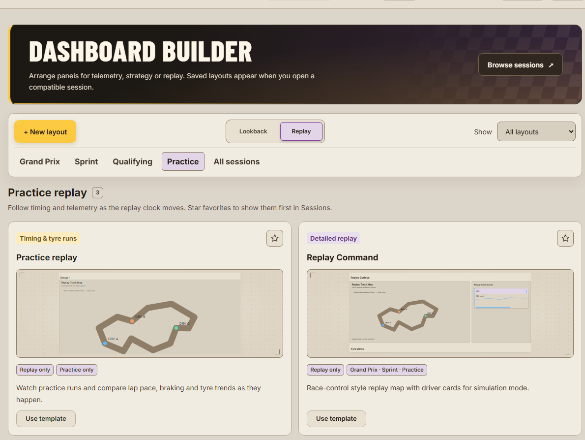

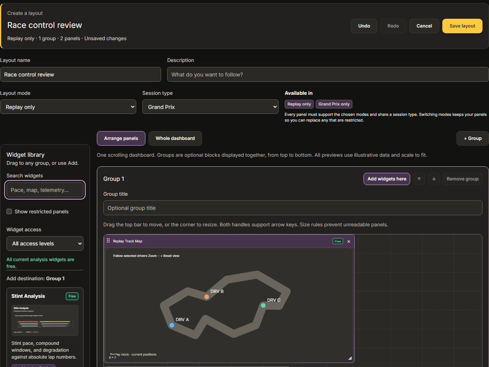

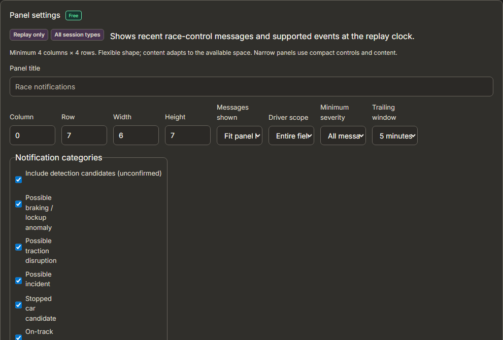

#### C.2. Pályatérkép és időmérés

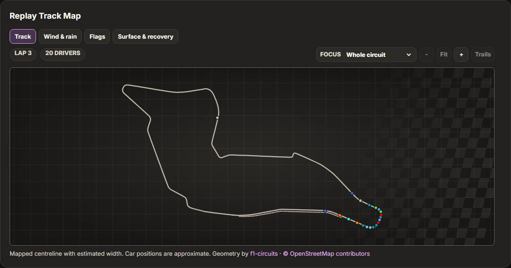

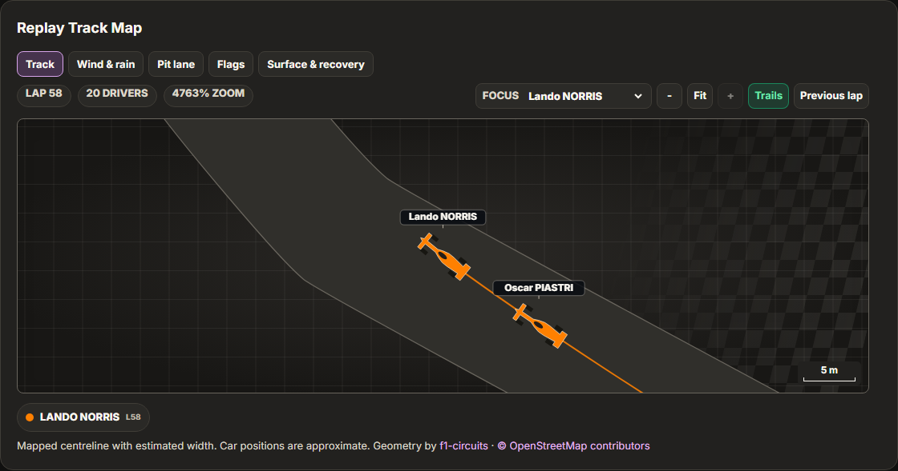

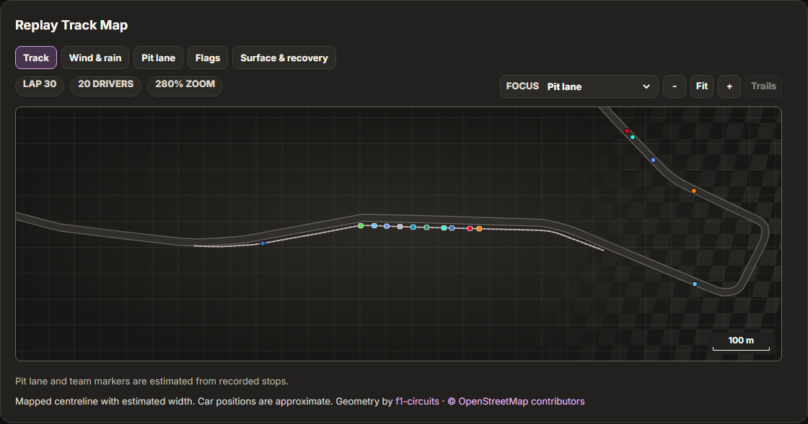

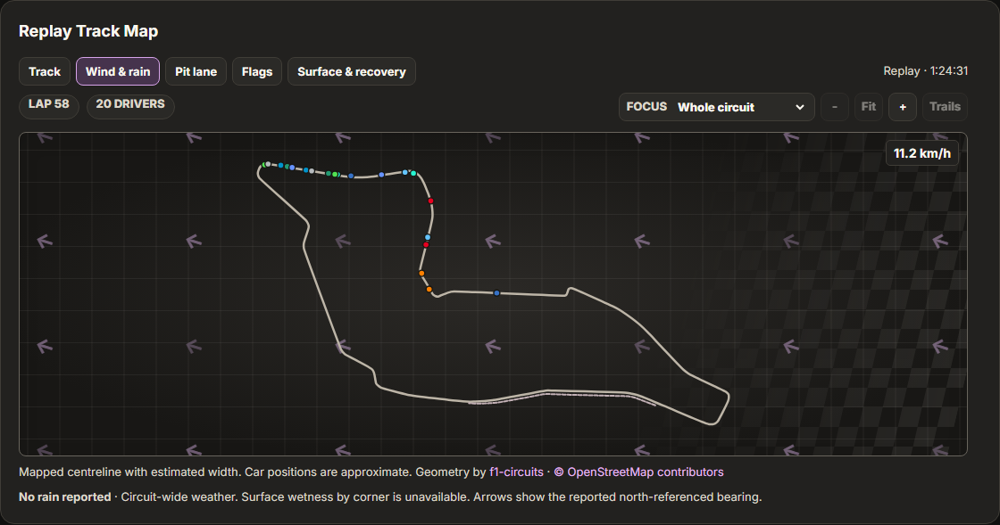

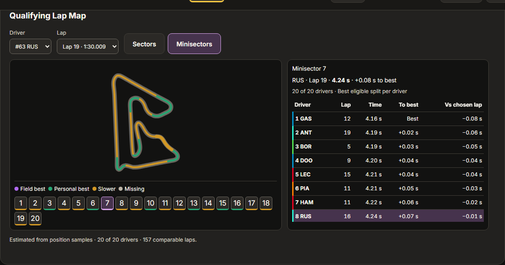

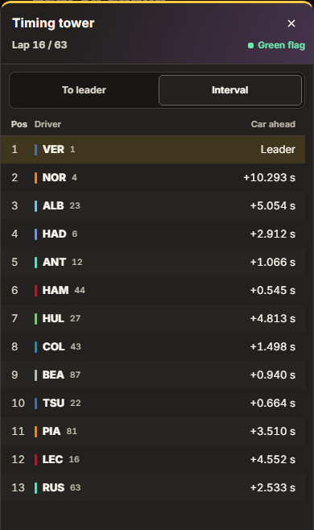

#### C.3. Futamesemények és gumihasználat

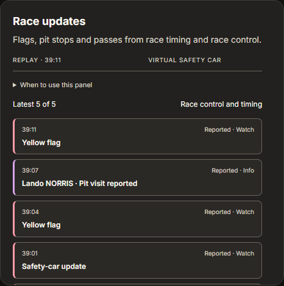

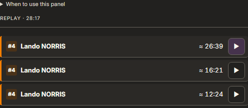

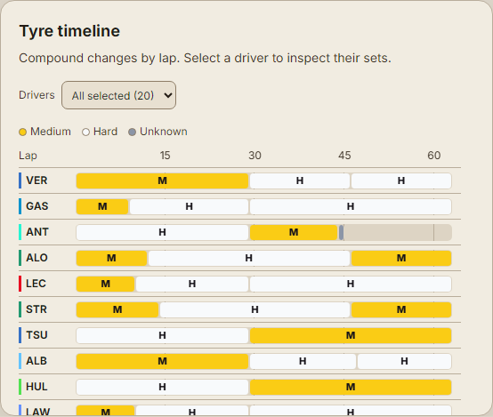

### D. Kiegészítő műszaki ábrák

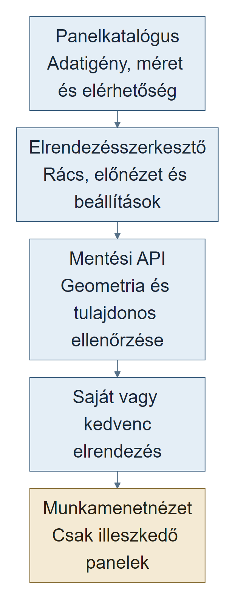

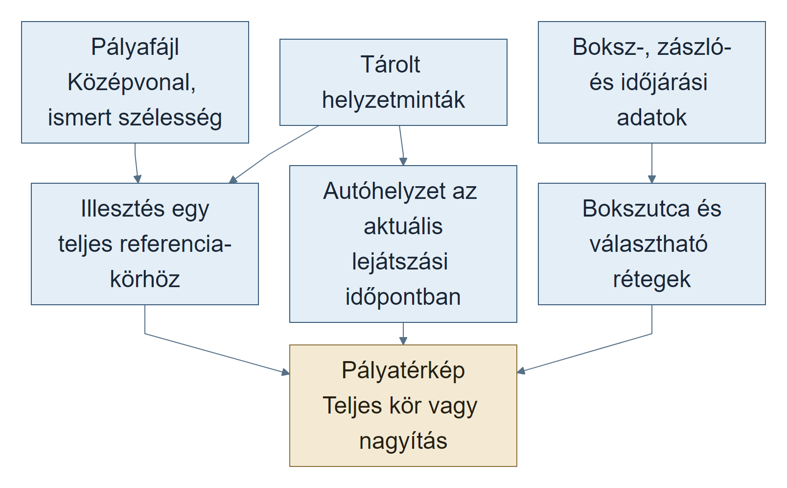
