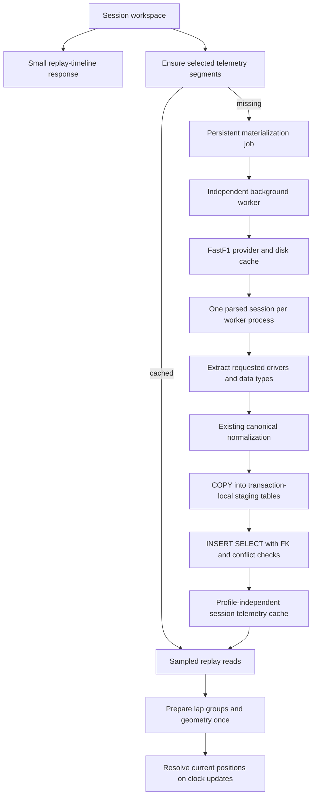

# Replay loading

## Findings on 2026-10-18

There were three independent failure paths:

1. The local telemetry jobs were queued with no start time and no worker process. Starting only Uvicorn does not process jobs. The UI previously kept saying that data was being prepared.
2. Full-session source parsing, conversion and normalization were repeated for individual widget requests, even when a request needed one data type for two drivers. Database writes used many individual parameter executions. Replay then requested up to 50,000 clock records and the first 20,000 telemetry records per driver, which could truncate the race.
3. The affected Chinese GP's F1 archive request returns HTTP 401 and the FastF1 mirror returns 404. This was reproduced locally without account credentials. The [upstream FastF1 issue](https://github.com/theOehrly/Fast-F1/issues/978) reports the archive access change around October 15. This is separate from PitWall account authentication. Upgrading FastF1 alone is not a demonstrated fix: that issue also affects 3.8.3; this repository remains pinned to 3.6.1.

FastF1 can catch telemetry failures internally and return a partial session. Empty results were previously marked as successful materialization. Full-session jobs now fail explicitly if an entire requested data type has no selected samples. Migration `a7d4e2c9b501` invalidates legacy completed session segments with zero rows once, so they are rechecked. A particular lap or one DNS/retired driver in an otherwise valid source load can legitimately be empty; those new verified segments remain cacheable to avoid endless requeueing.

## Structure

Module boundaries are retained. Ingestion owns the internal `TelemetrySelection` contract and parsed-source reuse. Normalization retains its canonical snapshot shape. Materialization owns persistence, queueing and cache readiness. Session domain owns the timeline and sampled read queries. Widgets use workspace resources rather than calling providers.

FastF1 still downloads/parses its provider telemetry feed as a session; selecting drivers does not make the upstream stream driver-specific. Selection prevents conversion and normalization of unwanted samples. The parsed cache holds at most one session per process; a different session replaces it. Force refresh bypasses this memory entry. Partial telemetry loads are not kept in memory across retries. Existing provider disk caches are retained.

## Persistence and reads

- COPY streams rows through the current SQLAlchemy transaction into temporary tables. A single `INSERT ... SELECT ... ON CONFLICT DO NOTHING` per table applies the real foreign keys and uniqueness constraints. The staging tables disappear on commit/rollback. Actual inserted counts are obtained with a returning CTE; driver executemany row counts were not reliable.
- Tick lookup reads only time/ID columns over the requested time range. It does not send one SQL parameter per telemetry timestamp.
- Migration `b8e5f3d0c612` creates the four car/position lap/stint foreign-key indexes already declared in the ORM models but missing from the database. They support lap reads and prevent large scans during relationship updates and cache cleanup. Indexes are created concurrently for populated caches.
- Heartbeats continue during source loading, normalization and persistence, including long SQL statements. Worker logs include source, normalization, persistence and total durations.
- `GET /api/sessions/{id}/replay-timeline` returns start/end bounds from existing lap metadata, with a tick-bound fallback. The frontend constructs a bounded clock and preserves the exact final time. Normal replay no longer downloads raw tick documents.
- Existing car/position routes accept optional `sample_interval_ms` from 100 to 10,000. PostgreSQL selects the first actual sample in each time bucket, after driver/lap/time filters. Unsampled lookback reads retain their existing behavior.
- Replay widgets request the whole race time range at a minimum 500 ms interval, increasing it for longer sessions to stay below 20,000 points. These reads preserve the end of the race. This is display sampling; the stored source samples remain at full resolution.
- Lap grouping, representative outline and smoothed lap geometry are retained between playback frames. Resource aggregation uses React Query structural sharing so the clock does not invalidate static geometry. Seeking resolves a new lap lazily.

The workspace waits until the roster is loaded before pruning unknown driver IDs. Previously a replay URL's selected drivers could be cleared during the initial empty loading state, accidentally requesting all drivers.

## Failures and authentication

An old queued job displays a background-service warning after 45 seconds and remains resumable. Failed source jobs show their reason in replay widgets. Jobs that are superseded by a broader selection cause readiness to be checked again. Completed/failed jobs stop polling. Read requests have a 60-second client timeout.

PitWall access tokens remain valid for 60 minutes. Active requests renew a valid token when fewer than five minutes remain using `POST /api/auth/refresh`. Concurrent requests share one renewal. The endpoint requires an existing user and a still-valid token; expired tokens require sign-in. Renewal responses cannot overwrite a sign-out or a different account. A protected 401 clears the corresponding local token and updates the authentication UI without repeated retries. This does not authenticate requests to F1's archive.

## Startup target and operating procedure

The startup target is **under 180 seconds to playable replay when the required provider data is available**. Cached replay should take substantially less. A blocked upstream archive cannot meet a successful cold-download target; it must show a clear error rather than wait indefinitely or pretend empty data is ready.

Use `scripts/start-backend.ps1` to start PostgreSQL, apply migrations and start both API and worker. It reuses an existing worker for this workspace and stops only the worker it owns. The worker retries temporary database failures. In deployment, run `python -m app.worker` as a separate supervised service alongside the API; starting only Uvicorn is insufficient.

Do not clear functioning FastF1 caches during the upstream archive restriction. Cached sessions remain usable. Restoring uncached 2024–2026 archive access requires an available provider or an explicitly configured, authorized upstream integration. No F1 account credentials or subscription tokens are embedded in this change.

Measurements and reproduction commands are in [replay validation](../testing/replay-validation.md).

## Queue integrity and current readiness

Ensure requests now acquire a session-scoped transaction advisory lock across cache backfill, job creation and segment queueing. Duplicate simultaneous requests reuse one job. Persistence uses a separate session lock before creating ticks or inserting samples, allowing independent workers to share the clock safely while readiness checks remain responsive. All segment/job mutations for ensure commit atomically.

Migration `c9f604e1d723` adds worker presence independent of individual job progress. A worker updates it every ten seconds, including while loading or persisting. Protected `GET /api/telemetry/materialization/health` reports ready/offline, workers seen within 45 seconds, queue age and running counts. Old presence rows expire; shutdown removes the current worker when possible. Transactional write heartbeat callbacks use the injected database binding, which keeps test workers inside their disposable schema.

The completed backend measured **93.687 seconds** for an empty database telemetry cache with 20 drivers and existing provider files. The final [backend readiness report](../testing/backend-readiness.md) contains the current 39-test results, migration verification, browser checks, machine-readable benchmark and source-access evidence. Those results supersede the earlier baseline counts in the original replay validation report.

The [backend analytics service](09-f1-analytics.md) remains outside replay loading. Successful telemetry materialization also aligns race-control UTC timestamps against the source feed clock and refreshes that small context atomically; it does not calculate analytics.
