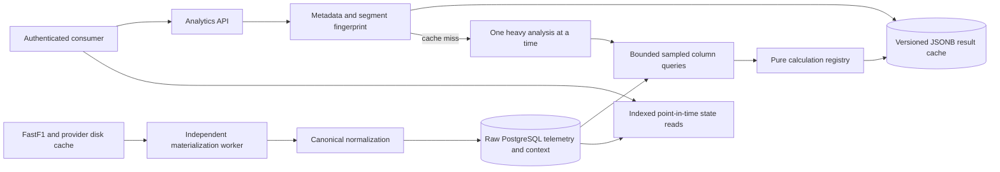

# Backend F1 analytics

The strategy implementation now has its own [decision-oriented catalogue](strategy-metric-catalog.md) and [detailed architecture, formulas, calibration requirements and runbook](10-strategy-foundation.md). Use that path for rival gaps, pit windows, tyre scenarios, incident risk and wind physics. This document covers the retained general diagnostics API.

This extends the existing `feature_metrics` module. The original driver scores and decision-engine endpoints retain their contracts. The new surface provides physical statistics, reported observations and explicitly inferred events. There are 137 implemented metrics in ten groups; the [generated catalogue](f1-metric-catalog.md) lists every ID, unit, input and definition.

## Data flow and responsibilities



`domain/analysis` contains only typed contracts, the catalogue, NumPy/SciPy geometry and pure calculations. It has no SQL, HTTP or source-provider calls. `infrastructure/analysis_input.py` owns bounded database reads and reference-lap selection. `application/analysis_service.py` owns concurrency, cache keys and orchestration. `state_service.py` owns small point-in-time reads. `delivery_api/api/feature_analysis_routes.py` only authenticates, validates and maps errors.

Replay never invokes analytics or waits for it. Analytics never imports missing sessions or creates materialization jobs. Missing inputs produce unavailable results with coverage information. Normal source samples remain at their original resolution.

## Routes

All three routes require the existing PitWall bearer authentication. Session datasets are shared across authenticated users, consistent with the existing session API; these endpoints contain no private dashboard/profile data.

| Method | Route | Purpose |
| --- | --- | --- |
| GET | `/api/feature-metrics/analytics/catalog` | Versioned definitions, units, input requirements and limits |
| POST | `/api/feature-metrics/sessions/{id}/analytics` | Compute or reuse selected statistics and bounded events |
| GET | `/api/feature-metrics/sessions/{id}/state?at_ms=...` | Last-known car state at one feed-clock timestamp |

Example analysis body:

```json
{
  "entry_ids": ["SESSION_ENTRY_UUID"],
  "groups": ["laps", "speed", "position", "incidents", "quality"],
  "sample_interval_ms": 500,
  "include_events": true,
  "max_events": 500,
  "options": {
    "rapid_drop_kph": 100,
    "rapid_drop_window_ms": 2000,
    "stopped_min_ms": 4000,
    "line_deviation_m": 15
  }
}
```

An empty body selects every metric and entry. `metric_ids` selects exact metrics; when combined with `groups`, the intersection is used. Unknown IDs, empty intersections, foreign entry IDs and inverted windows return 422. Missing sessions return 404. Optional `start_time_ms`, `end_time_ms`, `lap_from`, `lap_to` restrict the window. Telemetry uses `[start,end)`; completed-lap statistics require both lap boundaries inside the window. A selected lap range also filters each driver's samples by its actual lap foreign key, rather than treating all drivers' lap times as identical. Weather, status and race-control metrics describe session conditions over the resulting time window.

Each metric returns `metric_id`, `entry_id` (null for session metrics), `value`, `unit`, `status`, `confidence`, `sample_count` and `warnings`. Values may be a scalar, a per-stint list or a compound-count object as defined by the catalogue. Non-finite values are never serialized as JSON numbers. Missing values are null with `unavailable` or `insufficient_data`; zero counts remain valid where the count is observable. Confidence is a deterministic support heuristic, **not a calibrated probability**. Estimated/inferred metrics remain estimates even when coverage is complete.

Events have a kind, start/end feed-clock times, entry, evidence, confidence and `observed`, `reported` or `candidate` classification. At most `max_events` are returned, choosing the earliest events across all calculated groups/entries. Optional `event_kinds`, for example `["possible_incident"]`, filters events before capping so ordinary braking events cannot hide a later incident candidate. Allowed kinds are returned in the catalogue. `total_event_count` counts detected events matching this filter; `events_truncated` states when the returned list was capped. `include_events=false` omits events while retaining summary counts. Selecting individual metrics still evaluates their complete calculation group, so related events from that group may be included unless filtered.

## Sampling, units and quality

- PostgreSQL selects the first actual sample per entry and time bucket. This is display/analysis sampling, not an anti-alias filter or a replacement for stored raw telemetry. Short brake applications, rapid gear changes and peak forces can be missed. Request a smaller interval and window for closer investigation.
- Default interval is 500 ms; accepted range is 100–5000 ms. By default, the maximum continuous gap is `max(2000,2*sample_interval_ms)`. An explicit maximum must be at least the requested interval. Never interpolate or differentiate across larger gaps, invalid points or missing endpoints.
- Time-weighted channels use bounded observation intervals. The final sample has at most one nominal median sample interval of support, clipped to the window. Gaps receive zero support. Position proximity instead requires valid observations at both ends of its sampled time interval.
- Speed is km/h. Derivatives convert it to m/s; acceleration divides by 9.80665 to report g. FastF1's 2020+ XYZ coordinates are decimetres and are multiplied by 0.1 for geometric calculations. Position calculations are unavailable for unsupported sources/years instead of guessing a coordinate scale.
- Source weather wind is m/s and is converted to km/h on normalization. Migration `d0a715f2e834` corrects existing FastF1 weather values once. Wind direction uses a duration-weighted circular mean, so 359° and 1° average to 0°, not 180°.
- Missing/non-finite speed, speed outside 0–450 km/h by default, non-finite XY and `(0,0)` positions are unusable. Continuous XY steps implying speed above the limit are jumps; they contribute neither distance nor motion-derived forces. Longitudinal derivative spikes above 10 g are excluded. Heading change is path direction, not chassis yaw or steering angle; estimated lateral acceleration is capped at 10 g.
- `quality` exposes counts, supported duration, gaps, invalid channels, GPS jumps and repeated positions. Coverage is reported separately for each entry's car and position streams. Cross-driver proximity uses a shared clock and fresh, bounded interpolation, never differently timed raw points.

The source coordinate and channel definitions are documented in [FastF1's primary source](https://github.com/theOehrly/Fast-F1/blob/v3.6.1/fastf1/core.py); weather units and source status handling are in [the provider parser](https://github.com/theOehrly/Fast-F1/blob/v3.6.1/fastf1/_api.py).

## Calculation rules

| Area | Implemented rule and interpretation |
| --- | --- |
| Clean pace | Accurate, non-generated, non-deleted laps without pit entry/exit, excluding known non-clear lap flags, and lap times strictly between 10 and 600 seconds. Unknown lap flags are accepted when the source marks the lap accurate. No fuel, weather or traffic correction. |
| Consistency | Population standard deviation, median absolute deviation, coefficient of variation and p90 minus p10 over clean laps. Recent pace is the latest five clean laps; change compares the preceding up-to-five laps when at least six exist. |
| Sectors | Best/median/std per clean sector, theoretical best as the sum of three independent minima, and non-negative potential gain. This is not a promised attainable lap. Sector-sum mismatches exceed 100 ms. |
| Tyre trend | Per-stint ordinary least squares of clean lap time against reported tyre age; at least three usable points and varying age are required. Fuel load and track evolution are uncorrected, and confidence is capped. |
| Pit visits | Pair a recorded pit entry with the next unused later exit. Duration includes pit-lane travel; it is **not stationary pit-stop time**. Out-lap delta uses the same stint's clean median. |
| Distance and acceleration | Trapezoidal integral of speed over valid adjacent samples; finite difference of m/s over seconds for longitudinal acceleration. Position distance sums plausible XY steps. |
| Braking | Source boolean flag; continuous supported episodes, observed entry/release speeds, durations and throttle overlap. Specific braking energy sums positive decreases in `0.5*v²` while braking, in J/kg; vehicle mass, drag and energy recovery are unknown. |
| Powertrain | Reported RPM and gears 1–8. Shift counts sum observed gear-step magnitudes and exclude gaps/neutral/reverse. Historical source DRS codes 10, 12 and 14 indicate reported opening; they do not establish current regulatory eligibility. |
| Reference line | A completed accurate non-pit lap with position samples, known clear/empty lap flags, at least 20 finite points, closure gap at most 150 m, length 500–15000 m and no segment longer than 300 m. Five early candidates are tried; unavailable reference geometry stays unavailable. Projection uses nearby polyline segments. |
| Line deviation | XY distance from that sampled racing line. Time beyond 15 m is configurable; supported episodes of at least one second emit candidate events. Adjacent GPS jumps are excluded. There are no authoritative track-boundary polygons, so this is **not an off-track verdict**. Adjacent circuit sections can make projection ambiguous. |
| Reported OffTrack | The source's flag, counted only with usable coordinates. FastF1 can fill missing position records with this flag; even a reported episode does not prove an official track-limits breach. |
| Rapid speed drop | Drop of at least 100 km/h inside two seconds of continuous finite speed data by default. Overlapping detections merge. Ordinary F1 braking can meet this threshold. |
| Possible incident | A rapid drop followed within five seconds by a supported stop at or below 5 km/h for at least four seconds, outside known pit-in/out laps, matched pit visits with a five-second buffer, and known non-clear track periods. A linked driver incident message can add support. It remains a candidate; **never confirmed crash detection**. Missing pit/flag context limits interpretation. |
| Timing position | Latest completed-lap report and differences between reports. Grid gain, timing gains/losses and pit cycles are not asserted to be on-track overtakes. Field pace comparison uses the selected entries' fastest clean lap at each matching lap number. |
| Nearby cars | Simultaneous Euclidean XY distance, sampled at no less than one second. Proximity time means another observed car within 30 m; pit lanes, crossing paths and adjacent circuit sections can contribute. It establishes neither drafting nor contact. |
| Conditions | Weather means over covered intervals (weather gap cap 180 s); rainfall is a reported boolean. Track status intervals use 1 clear, 2 yellow, 4 safety car, 5 red, 6/7 VSC. Status 3 is unknown. Messages are counted by source text and structured driver association. |

Race-control `Time` is a UTC timestamp and `RacingNumber` identifies the driver. Normalization subtracts the true FastF1 feed-clock origin (`t0_date`), **not the scheduled race start**. Core imports can lack this origin because telemetry was not loaded; they do not invent message times. A successful telemetry materialization aligns and refreshes the entire session's messages atomically, including drivers outside the requested telemetry selection. Duplicate source messages collapse; unavailable context does not erase existing messages.

For an already-cached session that predates this fix, `python scripts/backfill_race_control.py SESSION_ID` resolves the source clock and updates only race-control context. It needs available provider data; it does not replace stored car/position telemetry. The validated Miami fixture was repaired this way.

## Point-in-time state

The `state` route uses two small lateral index reads per entry: the latest car observation and two latest position observations with timestamps **at or before** `at_ms`. It returns metre coordinates, source flags, channel values, observation ages, stale flags, estimated path heading, known pit-visit context, current lap number and the latest already-completed timing position. It never reads a later completed-lap position to classify an earlier instant. The reference lap must also have finished before that instant.

Observations older than 2000 ms, missing coordinates or unsupported units are marked stale. Coordinates remain clearly last-known; no extrapolation is performed. Geometric reference progress is an estimate, not an official race classification. No synthetic live ranking is presented as FIA timing.

## Persistence and operating limits

Migration `d0a715f2e834` creates `session_analysis_cache`. Keys include canonical options, selected entries/groups/metrics, algorithm version and a SHA-256 fingerprint of the session metadata import time plus every materialization segment's ID, status, update timestamp and row count. Metadata imports, message repairs, force refreshes and worker segment changes invalidate old keys; ordinary read access does not. If the fingerprint changes during calculation, return 409 and retry against stable materialization rather than saving mixed data.

Cache lifetime is 24 hours. At most 32 variants are retained per session, oldest first; expired entries are removed on a new calculation for that session. Session deletion cascades to cache rows. Cache hits do not query car or position samples. A local semaphore plus a PostgreSQL advisory transaction lock permits one expensive analysis across API processes within a database schema; disposable test schemas do not lock live requests. Busy work returns 429 with `Retry-After: 5`; cache hits and indexed state reads remain available. Workers use separate processes and their own persistence locks.

Requests allow at most 64 entries, twelve hours, one million combined sampled car/position records, and 5000 returned events. Exceeding the workload returns 413 with instructions to narrow the selection or increase the interval; data is never silently truncated. Input requirements load only the selected calculation groups' streams. This bounds application memory, although the selected PostgreSQL time range still has to be scanned for sampling.

Migration `e1b826a3f945` completes missing driver/team/race-control-entry FK indexes. Existing composite/prefix and explicit telemetry indexes are represented accurately in ORM metadata, avoiding redundant large-table indexes. `alembic check` now reports no pending operations; fresh-install and downgrade/upgrade tests cover the migration chain and weather repair.

## Adding a calculation

1. Identify the actual canonical source fields, their units, time base, missing-value meaning and supported years. If unavailable, report that limitation; do not invent a physical quantity from an unrelated signal.
2. Add the exact typed definition to `domain/analysis/catalog.py`: unique stable ID, group, output unit, required inputs, entry/session scope, interpretation and a precise description. Array/object outputs must have a documented stable shape in the calculation code and tests.
3. Implement a pure calculation in the matching group module. Accept prepared `AnalysisData`, `AnalysisRequest`, and `Results`; emit every registered metric for every applicable entry, including explicit unavailable results. Register a new group in `GROUPS` and `CALCULATORS` only when needed. The engine intentionally fails if a selected definition has no implementation.
4. If a new input stream is needed, add bounded column reads in `AnalysisInputProvider`. Apply time, entry and lap filters before sampling. Extend the combined sample limit and fingerprint when introducing new mutable data. Never call a provider from the calculation path.
5. Use shared finite-value, weighting, interpolation, pit-window and event helpers. Do not bridge gaps, mix coordinate scales, extrapolate future observations, count a timing change as an overtake or classify a slowdown as a confirmed crash. Record assumptions in definitions and warnings.
6. Add numerical ground-truth tests with independently known answers and units. Include missing/gapped/spiking data, boundary times, selected entries, unsupported inputs and relevant false-positive cases. Test new API validation/cache invalidation when the input or contract changes. JSON output must serialize with `allow_nan=false`.
7. Bump `ANALYSIS_VERSION` when changing released formulas, semantics or output shapes so old persisted answers are not reused. Add migrations for persistent schema changes; never rely only on `create_all` for a running installation.
8. Run `python scripts/export_analytics_catalog.py`, update this runbook if assumptions changed, run the full backend suite, and measure a realistic session with `scripts/benchmark_analysis.py`. Recheck replay performance if the change touches ingestion, normalization or materialization.

## Validation

Run from `backend` with PostgreSQL and the local API available:

```powershell
.\.venv\Scripts\python.exe -m pip install -r requirements-dev.txt
.\.venv\Scripts\python.exe -m alembic upgrade head
.\.venv\Scripts\python.exe -m unittest discover -s tests -v
.\.venv\Scripts\python.exe scripts/benchmark_analysis.py 83b766df-f250-4293-8b72-15f481ea039b --output ../docs/testing/analytics-benchmark-2026-10-18.json
```

New integration tests create and drop only randomly named disposable PostgreSQL schemas; the production worker cannot consume their jobs. Existing live-route tests create temporary accounts and remove them afterward. Numerical tests cover acceleration, energy, coordinate scaling, circular wind, tyre slopes, ordinary braking versus possible incidents, pit/flag exclusions, stale interpolation, geometry, exact driver association and bounded chronological events. Integration tests cover authentication, ownership, all registered metrics, windows, state without future data, cache hits/invalidation/storage bounds, input limits, busy responses and data changing during calculation.

Measured results and source-access limits are recorded in [backend readiness validation](../testing/backend-readiness.md).
