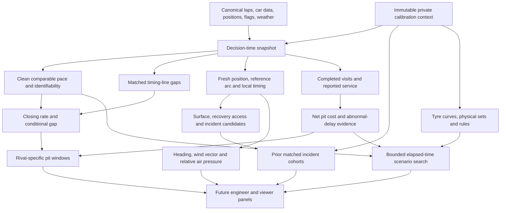

# Strategy foundation: deterministic calculations, evidence and decision boundaries

The strategy path contains **67 decision-oriented calculations** and a bounded zero/one/two-stop scenario search. Its purpose is to turn known race observations into reusable pace, rival, pit, incident, airflow and risk inputs for future panels and a more complete strategy optimizer. It runs without AI.

Start with the [generated calculation catalogue](strategy-metric-catalog.md): every calculation has a stable ID, scope, unit, formula, prerequisites, interpretation limits and a concrete consumer. This document defines the exact algorithms, output contracts, assumptions and extension process. The earlier [137 diagnostic statistics](f1-metric-catalog.md) retain their existing API; they are not automatically fed into strategy decisions.

## What can be precise

Arithmetic can be reproducible without its physical inputs or future predictions being exact. The API makes the distinction explicit:

| Status | Meaning | Example |
| --- | --- | --- |
| `observed` | A source observation or count of source records | A completed pit-lane visit lasted 22.440 s |
| `derived` | Deterministic transformation of observed inputs | Difference between two timestamps at the same timing line |
| `estimated` | An approximation, statistical fit or conditional forecast | Geometric progress, closing trend, historical SC probability |
| `assumed` | A declared scenario input or result dependent on it | Supplied tyre curves, remaining distance or hypothetical pit cost |
| `unavailable` | Required information is missing or cannot be identified | Wind components without geographic alignment; SC probability with too few matched labels |

Percentage fields are either an explicitly defined fraction of observations, a physical ratio, or a statistical probability with its own evidence. A confidence score is never multiplied by 100 and presented as crash, SC or pit-success probability.

Each `StrategyValue` carries `metric_id`, `entry_id`, optional `rival_entry_id`, `value`, `unit`, `status`, `sample_count`, `as_of_ms`, `support`, `warnings`, and optional typed `bounds`. Bound meanings are intentionally distinct: `sensitivity_range`, `sampling_band`, `coefficient_interval_95`, `conditional_prediction_band`, and Bayesian `credible_interval_95`. Sensitivity ranges are not asserted to have 95% coverage. Decimal serialization is not a claim about measurement resolution; display precision must follow source resolution and the attached assumptions.

## Architecture and reusable dependency chain



Existing module responsibilities are preserved:

- `feature_metrics/domain/strategy/` owns pure features, contracts, the catalogue, geometry calibration and statistical risk primitives.
- `feature_metrics/infrastructure/strategy_input.py` reads bounded canonical data and private context versions.
- `decision_engine/domain/strategy_planner.py` consumes features and explicit assumptions to enumerate plans.
- `decision_engine/application/strategy_service.py` orchestrates those layers and caches results.
- `delivery_api/api/strategy_routes.py` authenticates, validates and translates failures.
- `ingestion/infrastructure/openf1_strategy_adapter.py` is an optional enrichment adapter. It is invoked explicitly by a separate export script, never from replay or strategy evaluation.

The API does not download missing feeds, create telemetry jobs or delay replay. New data must arrive through ingestion/materialization and update the existing session/segment revision fingerprint. A future live-feed adapter can use the same calculation path after storing canonical samples; a live subscription transport is not added by this feature.

## Decision time, provenance and replay integrity

Every request specifies `as_of_ms` in the existing FastF1 session/feed clock. It is not wall-clock elapsed race time. The provider bounds sample reads to the requested telemetry lookback and cutoff. Pure calculations independently apply the cutoff again:

1. Exclude car samples, positions, weather, track flags and messages after the decision time.
2. Exclude laps that have not started. A current lap exposes only its already-observed start, timing-sector crossings and pit timestamps; future lap time, position, compound, tyre life, end, deletion/accuracy outcome and other results are unavailable.
3. Use completed lap results only after their end timestamp. Generated laps are not treated as observed timing crossings.
4. A reference lap must have completed by the cutoff. A later fastest lap cannot provide an early-replay racing line or transit-time model.
5. Context versions must have `known_at_ms <= as_of_ms`. Each external pit report has its own additional `known_at_ms` gate.
6. Historical incident labels must have completed their outcome horizon before the target race's scheduled start. A later event in this race cannot train an earlier prediction.

Tests poison future laps, compounds, pit timestamps, positions, speed and flags and verify unchanged past values/models. A cache miss caused by a new source revision recomputes the same historical decision when the new facts occur after its cutoff.

This is **event-time replay**, not a complete reconstruction of original information arrival. Historical FastF1 accuracy/deletion flags can be revised after a race, and the database does not contain their original publication stream. `known_at_ms` on manual contexts is an assertion by the producer. The API exposes `arrival_time_reconstruction=false`. A future strict live backtest needs an append-only fact log with source-event time, received time, revision/supersession time, source sequence and provider identity; adding a timestamp today cannot recover historical arrivals.

## Rival calculations: timing, distance and catch forecasts

For each focus/rival pair, construct matching crossings keyed by `(lap_number, sector_number)`. Use source sector-session times where available and completed lap end for sector 3. Both drivers must already have crossed that line. The signed measured gap is:

`g = (focus_crossing_ms - rival_crossing_ms) / 1000`.

Positive means the focus is behind. This is an equal-location timing gap, not a simultaneous snapshot of two cars. Keep up to sixty latest matched crossings and return their actual timestamps and gaps in `pair_series`.

The robust pace advantage is the median of `rival_clean_lap_s - focus_clean_lap_s` on the latest five matching clean lap numbers. The closing-rate estimate is the negative Theil-Sen slope of the latest ten matched clean end-lap gaps against their observation clocks. Theil-Sen uses the median of all valid pairwise slopes; it resists isolated poor laps better than a first-to-last difference.

With positive closing rate `c`, projected decision-time gap is `g_now = g_last - c * observation_age_s`. Projection is rejected if the anchor is more than one current pace lap old (capped at 120 s), if a pit timestamp occurred after the anchor, or if the intervening track interval is not explicitly clear. If there is no trend yet but the anchor is usable, a constant-gap assumption is exposed. Catch time is `g_now / c` only for positive gap and positive closing rate. It predicts catching at unchanged conditions, not successfully overtaking.

Geometric distances use a shared one-second clock and bounded interpolation with finite endpoints, no extrapolation and no interpolation across long gaps or implausible movements. Euclidean distance is explicitly separate from signed reference-arc race distance. Arc progress combines the already-started lap number with projected position on the reference line, excludes known pit visits and points more than 15 m from the line, and rejects implausible progress jumps. Adjacent sections, bridges and reference-start alignment remain limitations. `rival_pair_coverage_pct` reports supported instants rather than hiding lost data.

The close-following percentage is the fraction of matched timing crossings with `0 < gap <= 2 s`; it is not an independently sampled duration and not a drafting probability. Mean geometric distance, mean timing gap and along-track separation have different uses and should keep their full names in panels.

### Measured forecast accuracy

The [Miami walk-forward test](../testing/strategy-gap-backtest-miami-2025.json) predicts the **next matched lap's gap** from the last observed gap and the prior five-lap relative pace. Only the prefix is used to make each forecast. Future flags are used later to stratify errors, never to choose inputs.

| Evaluation | Samples | Mean absolute error | Unchanged-gap baseline |
| --- | --- | --- | --- |
| All next-lap targets | 52 | 1.298 s | 1.640 s |
| Continuing green, non-pit targets | 45 | 0.386 s | 0.706 s |

This one-race, one-pair result is not a production accuracy guarantee or a counterfactual pit-strategy validation. Pit stops and neutralisations break the constant-condition assumption. General promotion requires chronological holdout across circuits, seasons, wet/dry conditions, traffic states and pit/flag changes.

## Pace, tyre wear and identifiability

Strategy clean laps require explicit clear source lap status `1`, accuracy, no generated/deleted record, no pit entry/exit, a completed end, and a plausible 10–600 s lap time. Unknown lap flags are not treated as clear. Recent pace is the latest five-lap median; scatter is `1.4826*MAD` over ten laps; the latest-lap residual compares against preceding clean laps. These remain observational statistics, with no automatic fuel, traffic or wind correction.

The optional retrospective fit is:

`lap_time_s = driver_intercept + compound_offset + compound_age_slope * tyre_age + common_race_lap_slope * race_lap + residual`.

Use driver and compound indicator columns, compound-specific age columns and a common race-lap column. Standardize columns, inspect singular values and rank, reject constant required predictors, reject condition number above `1e8`, and require more observations than parameters plus five. Only then solve least squares and report conditional coefficient intervals from the residual variance and inverse normal matrix. The interval assumptions include independent, constant-variance errors; serial correlation and omitted conditions can widen real uncertainty.

The common race-lap trend mixes fuel burn, evolution and other shared changes. It is not a fuel measurement. Weather effects are not quietly absorbed into a tyre-causation claim. For a single uninterrupted stint, tyre age is `race_lap - constant`, making wear and common race-lap trend collinear. Infinitely many wear/fuel coefficient pairs fit equally well. The system returns `unidentifiable`; it does not stabilize an arbitrary coefficient with hidden regularization and call it precise.

The real Miami midpoint fit was unidentifiable. Therefore it was **not** automatically converted into future tyre curves. Strategy scenarios require explicit curves with compound, base offset, linear and optional non-negative quadratic age term, warmup deltas, maximum valid age, uncertainty, provenance and source. A future learned curve must first pass an appropriate calibration/prediction validation protocol.

## Pit durations and net race cost

Keep three quantities separate:

1. **Pit-lane visit duration:** source pit-out timestamp minus its matched earlier unused pit-in timestamp. This includes travel, service, waiting and other lane effects.
2. **Stationary service duration:** a separately reported stopped-service measurement. It cannot be recovered merely by relabelling the whole visit.
3. **Net pit loss:** elapsed race-time cost compared with continuing along the racing surface. It is not generally equal to either duration above.

Completed visits are paired and deduplicated by timestamp. Comparable lane baselines use at least three other visits under a stable matching track phase. A long visit is described as excess visit time; it does not, by itself, prove a wheel-change mistake.

An empirical net-loss candidate uses consecutive in/out laps and their adjacent clean neighbors:

`estimated_loss = inlap_s + outlap_s - preceding_clean_s - subsequent_clean_s`.

All four laps must be completed by the cutoff, the stop must span consecutive laps, the relevant interval must remain clear and at least three eligible visits are required before producing a field median and robust scatter. This retrospective estimator still mixes tyre change, warmup, traffic, execution and evolving conditions. Configured green/SC/VSC net-loss models retain their own provenance and sensitivity instead of claiming a universal SC percentage discount.

### Actual pit-service enrichment

[OpenF1's documented pit resource](https://openf1.org/docs/) distinguishes `lane_duration` and `stop_duration`; stationary coverage begins with the 2024 US GP. The adapter keeps absent service data unavailable and validates source session, roster, timezone, positive durations and service not exceeding total lane duration. It never guesses a source key from a driver number alone.

`fetch_strategy_pits.py` verifies the selected source session's year, name and start against the imported session, derives the feed-clock origin from dated canonical telemetry, and exports a context for inspection. It conservatively gates each report at source date plus the larger visit/service duration plus 15 seconds. The source date's exact point in the visit and original publication delay are unspecified, so this is not advertised as historical arrival-time reconstruction.

The [real Miami export](../testing/miami-2025-pit-context.json) contains eighteen lane/service reports. At the validated midpoint, the focus driver's source visit was **22.440 s** and service was **2.7 s**. These observations are different from the synthetic 20 s net-loss assumption used only to exercise the scenario workflow.

### Next reachable pit entry

If a verified track profile supplies pit-entry progress and fresh position can be mapped reliably, calculate forward arc distance to that entry. If the current reference progress has passed it, wrap to the next lap rather than claiming the missed entry is still available.

The reference line optionally stores its own past lap's sample times. Forward transit time interpolates that local timing trace and wraps across the finish, then scales to the focus driver's current median pace. Without timing trace, the explicitly labelled fallback uses lap-average speed. Bounds are sensitivity to changed traffic/braking/conditions, not a promised arrival time. The projected tyre age includes the travel to the reachable decision boundary.

Rival gap can be propagated through that ETA using its known closing trend. If entry geometry is missing, the output exposes the assumption that the gap stays constant until the next reachable entry. A car already in a pit visit, or whose post-stop fitted tyre is not yet observed on a completed lap, does not receive a second hypothetical immediate pit charge or a guessed new compound.

## The rival's bad-stop opportunity: worked counterfactual

Suppose a completed rival stop has already been incorporated in a fresh shared timing crossing:

- Actual signed focus-to-rival gap is `-22 s`: focus is 22 seconds ahead.
- Focus net pit cost is `20 s`.
- Independently observed comparable service/visit excess for the rival is `5 s`.

Actual projected rejoin gap is `-22 + 20 = -2 s`: still two seconds ahead if the rival stays out. The normal-rival-stop counterfactual is `-22 + 5 = -17 s`; stopping under that counterfactual gives `-17 + 20 = +3 s`, three seconds behind.

The opportunity exists specifically because of the abnormal rival delay. Its boolean is true only when the actual rejoin upper sensitivity bound is ahead and the normal-stop counterfactual rejoin lower bound is behind. If focus was already 30 seconds ahead, the normal stop would still permit pitting ahead, so this specific flag is false.

Never subtract the rival's entire stop again from a post-stop measured gap. If its stop has not yet been incorporated in an observed timing anchor, the projection is unavailable. Prefer a known stationary-service excess when it can be tied to that completed visit; otherwise label comparable total-visit excess honestly. Rival response, overtaking, traffic, pit execution and legal/available fresh tyres still determine whether exploiting the window is actually the best strategy.

## Incident, track surface and recovery context

Rapid deceleration is common in ordinary F1 braking. The incident feature layer therefore separates:

- short-window speed loss;
- supported continuous stop duration with a fresh end observation;
- normal pit visits;
- fresh/invalid/stale positions;
- signed clearance to supplied racing-surface polygons with a position-error band;
- straight-line proximity to supplied recovery access points;
- candidate collision and candidate retirement, never confirmed mechanical/crash cause.

Speed drops require continuous plausible samples. Position teleports do not become off-track retirement candidates. Disappearance of telemetry produces a stale state, not retirement. A sustained stop outside a known pit can become an incident candidate; off-track/recovery evidence adds context. Spatial classification stays `unknown` inside the error band. Typical position uncertainty may be wider than half a track's width, so even a good boundary polygon cannot make the raw observations an exact lateral-placement measurement.

The source position caveat is documented by [OpenF1](https://openf1.org/docs/). The existing FastF1 circuit metadata provides display-oriented circuit information, not a surveyed recovery-access network or guaranteed geographic north. Its map rotation is not used as a wind-bearing calibration.

### Geometry import and calibration

`TrackProfile` declares the circuit, exact session metre coordinate frame, validity years, source URI, north angle/error, position error, optional surface/pit/recovery zones, optional access points and pit-entry progress. Profiles with the wrong frame or season are rejected. Source data is not silently shifted into place.

`align_metric_landmarks()` fits a proper rotation, near-unit scale and translation from at least three non-collinear corresponding metric XY and east/north landmarks. It rejects reflected pairing, a scale mismatch above two percent and excessive residuals, and returns residual/error information with the recovered north angle. The caller must obtain surveyed metric ENU coordinates in a documented geodetic projection; degree-valued longitude/latitude is not a metre input.

`fetch_strategy_map.py` exports bounded-area OSM raceway/service/escape **line candidates** as attributed GeoJSON. [OSM raceway mapping](https://wiki.openstreetmap.org/wiki/Tag:highway%3Draceway) does not establish racing-surface boundaries or certified marshal access. Candidate lines require source review and georegistration before becoming strategy zones. The attempted Miami fetch timed out on the DE endpoint and returned 500 on the alternate endpoint; no fabricated map, road width, exit or north calibration was installed.

## Wind physics and the limit of lap-time attribution

Coordinate convention: track XY must be right-handed; geographic bearings are clockwise from north and indicate where wind comes **from**. With verified north/east unit vectors `n,e`, reported bearing `b` and wind speed `w` in m/s:

`wind_velocity = -w * (sin(b)*e + cos(b)*n)`.

For heading unit vector `h`, right vector `r` and observed ground speed `v`:

`headwind = -wind_velocity·h`

`crosswind_right = wind_velocity·r`

`relative_air_velocity = v*h - wind_velocity`.

The relative-air magnitude and `atan2(relative_air·r, relative_air·h)` provide airflow/yaw inputs. Path heading and left/right turn direction come from bounded, plausible position differences; they are not chassis yaw or steering-wheel angle. Wind components remain unavailable if verified north alignment is missing, its declared angular error exceeds ten degrees, heading/speed is unusable or weather is stale.

Moist density uses pressure, temperature, humidity and saturation vapour pressure. Dynamic pressure is `q = 0.5*rho*|relative_air_velocity|²`; relative pressure change is `100*(|relative_air_velocity|²/v² - 1)` when ground speed is sufficient. At 100 m/s ground speed with a 10 m/s tailwind, relative airspeed is 90 m/s and pressure changes by **-19%**, not “-10% wind” or “19% lap-time improvement.” These equations follow standard [dynamic-pressure physics](https://www1.grc.nasa.gov/beginners-guide-to-aeronautics/dynamic-pressure/); actual force additionally needs calibrated aerodynamic coefficients and area, as described by [NASA](https://www1.grc.nasa.gov/beginners-guide-to-aeronautics/aerodynamic-force/).

Station wind is not measured local airflow at each corner. A wind-to-lap-time correction requires car/track aero response, yaw sensitivity, downforce/drag balance, grip, speed profile and a validated residual model with fuel/traffic/evolution controls. The backend supplies the physical inputs and preserves `weather_causally_corrected=false`; it does not subtract an invented wind penalty and call the rest tyre wear or a driver mistake.

## Safety-car probabilities and calibration

Probability is estimated only for an active, fresh, non-pit incident under green/local-yellow conditions. An existing SC/VSC/red state or a known finished/inactive race is not treated as a future deployment prediction. Multiple active cars need a joint incident model; their risks are not multiplied as independent events.

Match labelled earlier incidents by circuit, stopped state, surface class, recovery-access class, elapsed-stop bin (`4_10`, `10_30`, `30_plus`) and fixed forecast horizon. Different elapsed bins matter: an incident that has already remained unresolved for thirty seconds is not the same forecasting situation as its fifth second. The default horizon is 120 seconds and minimum cohort is thirty independent incidents; both are explicit inputs. This minimum is a display gate, not proof that thirty events yield a precise model.

Two probability families have different meanings:

1. **Occurrence:** SC, VSC or red may each occur within the horizon. Each known binary label uses a Beta(1,1) posterior: mean `(successes+1)/(n+2)` and a central 95% beta-quantile interval. These occurrences can overlap and need not add to 100%. A case with SC followed by red still counts as SC occurrence. Unknown occurrence labels block that estimate rather than being selectively discarded.
2. **Highest-response distribution:** classify each incident as `red > SC > VSC > none`, then use Dirichlet(1,1,1,1). Posterior class mean is `(class_count+1)/(n+4)`. These four mutually exclusive means add to 100%, but do not replace occurrence probability.

The response includes cohort count, prior, conditioning state, horizon, source incident and calibration status. Chronological expanding-window Brier scoring uses earlier labels to forecast later labels; it is a diagnostic, not a claim of independently demonstrated calibration. Missing geometry does not automatically borrow an off-track or recovery-zone cohort; it matches only the `unknown` class.

`collect_incident_history()` and its export script build inspectable stopped-car observations from already-materialized telemetry and track flags. They exclude known pits, skip nearby multi-car events rather than double-counting them as independent single-car incidents, distinguish elapsed bins, and **censor** cases without the complete outcome horizon. The same incident contributes at most once to each matched elapsed-time cohort. Unknown flags are not labelled as “nothing happened.” Surface and recovery stay unknown without verified historical geometry.

The real Miami export contains five observations across elapsed bins, not five necessarily independent incidents for one cohort. It is insufficient for a defensible current SC percentage, and observations from Miami 2025 are not allowed to calibrate that same race's earlier decisions. A deployable estimator needs substantially more appropriately labelled history, provenance review, chronological/circuit holdouts, probability reliability checks, Brier/log loss, missingness/censoring audits and regime-change review. No fixed risk weights are disguised as probabilities.

## Bounded strategy search

The current search is an implemented scenario optimizer, not a complete stochastic race simulator. It requires:

- known last-completed compound/age and clean pace;
- explicit remaining complete laps from the next reachable decision boundary;
- compound curves with a maximum supported age;
- individually identified available tyre sets, including prior age;
- green and, where applicable, SC/VSC net pit-cost assumptions;
- a season-matching explicit rule profile.

The rule profile supplies required distinct compounds and minimum stops. There is no permanently hard-coded “all F1 races need exactly two compounds” rule. Actual eligibility must be checked against the relevant published [FIA rules and event documents](https://admin.fia.com/regulation/category/110), race format, wet conditions, penalties and event-specific requirements. Supplied rules are not automatically certified just because the JSON validates.

For a stint, relative lap cost is `base_compound_delta + linear_age*age + quadratic_age*age² + fitted-set warmup_delta`. Start from current clean pace with the declared current tyre effect removed to obtain a common base. Sum future stint costs plus net pit costs. Curves are not extrapolated beyond supported age. Warmup applies to newly fitted sets; their initial physical age can already be nonzero.

The enumerator evaluates staying out, every one-stop boundary and every ordered two-stop boundary/set combination, with strict increasing stop offsets and no reuse of the same physical set. Prefix sums give constant-time segment costs; only the best twenty plans are materialized as outputs. Counts and the best cost for every first-stop offset are retained. Limits are eighty remaining laps, two stops and twelve available sets. The feasible count reports how much search actually occurred.

`best_modeled_plan` minimizes elapsed time among candidates satisfying configured rules and inventory. It is not necessarily the plan with maximum win/points probability: that requires field interactions and validated passing/traffic models. Its sensitivity range propagates declared per-lap and pit-cost ranges conservatively, not by assuming independent errors and dividing by square root of sample count. The first-stop window reports offsets within a stated near-optimal cost tolerance instead of presenting a falsely exact mandatory lap.

Conditional undercut break-even compares accumulated projected old-rival versus fresh-focus tyre advantage with a positive observed gap. It assumes a common baseline and does not silently add unknown rival response, traffic, in-lap execution or passing behavior. Rejoin rank is available only with fresh gaps for the complete selected roster; partial pair coverage is not represented as a full-field classification.

The immediate-stop cost can use the current SC/VSC model. Later stops assume green cost; future neutralisation timing/duration is unknown. Current suspension/unknown phases reject the relevant plan, and a known finished/inactive race requires explicit `mode="counterfactual"`. An already-started pit visit or unseen post-stop tyre change blocks advice until tyre state is observed.

## API and private saved context

| Method | Route | Purpose |
| --- | --- | --- |
| GET | `/api/strategy/catalog` | Machine-readable formulas, units, uses and limitations |
| POST | `/api/strategy/sessions/{id}/evaluate` | Cutoff-bounded feature/plan evaluation |
| POST | `/api/strategy/sessions/{id}/contexts` | Save an immutable private calibration/scenario version |
| GET | `/api/strategy/sessions/{id}/contexts/{context_id}` | Retrieve that version with owner/session checks |

All endpoints require the existing bearer account. A different account receives 404 for private contexts. Session IDs and every inventory/report entry are validated. Wrong season/frame, invalid duration/range, too-large payloads, non-finite values and future-known contexts are rejected. An immutable context contains source notes, optional surveyed track data, known pit reports, tyre curves/sets, pit loss, rules and historical calibration. Optional does not mean a missing prerequisite is guessed.

Example evaluation body:

```json
{
  "mode": "race",
  "as_of_ms": 6146502,
  "focus_entry_id": "SESSION_ENTRY_UUID",
  "rival_entry_ids": ["RIVAL_ENTRY_UUID"],
  "context_id": "PRIVATE_CONTEXT_UUID",
  "remaining_laps": 20,
  "max_stops": 2,
  "telemetry_lookback_ms": 180000,
  "sample_interval_ms": 500,
  "race_horizon_s": 120,
  "min_probability_cohort": 30
}
```

Omit rival IDs to evaluate all roster rivals. Omitting remaining laps or calibration still returns available features and explicit planning readiness. The response includes values, pair series, incident-state events, fitted-model diagnostics, candidate plans, optional best modeled plan, recommendation status, readiness and warnings. Missing model inputs are a successful feature response with no fabricated plan.

Cache keys include algorithm version, session data fingerprint, account, context content hash, decision time and all options. Strategy results expire after one hour; at most thirty-two strategy variants are retained per session. A shared compute gate and schema-scoped advisory lock bound heavy analytics/strategy work while cache hits stay cheap. If data changes during computation, return 409 and retry. Work limits return 413; a busy slot returns 429 with `Retry-After`.

Migration `f2c937b4a056` adds immutable `strategy_context_versions`. `g3d048c5b167` adds nullable ownership to the shared derived-cache table. Existing general diagnostics remain shared; private strategy contexts and results cascade when the owning profile is removed. Sources and original telemetry are preserved.

## Validation and operating runbook

The complete local backend suite has **66 passing tests**. Strategy-specific tests check independently calculated rival gaps, physical wind direction/pressure, rank-deficient fits, known multivariate coefficients, future-data poisoning, post-stop/finished-race gates, geometry jumps/error bands, categorical versus overlapping probabilities, censoring, frame/unit registration, private context ownership/cascade, cache reads, sample limits and the best one/two-stop cost against separate lap-by-lap enumeration.

The [authenticated Miami benchmark](../testing/strategy-api-benchmark-miami-2025.json) returned 562 values in 0.329 s and a cached repeat in 0.031 s. Its scenario search evaluated 421 candidates, with 400 feasible and twenty returned. Telemetry and reported pit service were real; tyre curves, inventory, net pit loss and rule settings were **explicit synthetic scenario assumptions**, so that run validates the workflow rather than proving a real optimal strategy. Both existing browser workflows pass; cached full-grid replay remained playable in 8.79 s.

From `backend`, with API/worker/PostgreSQL running:

```powershell
.\.venv\Scripts\python.exe -m alembic upgrade head
.\.venv\Scripts\python.exe -m alembic check
.\.venv\Scripts\python.exe -m unittest discover -s tests -v
.\.venv\Scripts\python.exe scripts/export_strategy_catalog.py
.\.venv\Scripts\python.exe scripts/fetch_strategy_pits.py SESSION_ID --openf1-session-key 10033 --output pit-context.json
.\.venv\Scripts\python.exe scripts/export_strategy_incident_history.py HISTORICAL_SESSION_ID --circuit-key miami --output incident-history.json
.\.venv\Scripts\python.exe scripts/backtest_strategy_gaps.py SESSION_ID --focus-car 1 --rival-car 4 --output gap-backtest.json
.\.venv\Scripts\python.exe scripts/benchmark_strategy.py SESSION_ID --context-file pit-context.json --exercise-scenario --output strategy-benchmark.json
```

OpenF1 key 10033 is the tested Miami 2025 race; other sessions require their own verified source key. Export scripts do not mutate the database. The benchmark saves temporary private contexts under a temporary account and verifies cascading cleanup. `--exercise-scenario` deliberately supplies toy model assumptions and must remain labelled in evidence.

### Adding a useful strategy primitive

1. Name its consumer and decision. If it does not change another calculation, expose evidence/quality or communicate a useful race fact, keep it out of the primary strategy catalogue.
2. State scope (entry/pair/session), sign convention, units, clock, observation availability, missing-value rule, exact equation and whether it is observed, estimated or assumed. A pair metric must specify matched timing lines versus simultaneous positions and which driver is ahead for each sign.
3. Add a stable definition to the strategy catalogue and a pure calculation in the appropriate feature module. Put decision search/policy in `decision_engine`, not ingestion or a widget. Reuse shared helpers for cutoffs, clean laps, timestamps and input validity.
4. Implement every numeric path, and explicitly gate missing inputs. An unavailable path needs a reason and evidence requirements; it is not permission to return an arbitrary default coefficient. If estimating probability, define outcome/horizon/cohort, label acquisition, censoring, dependence, prior and held-out validation before adding a `%` field.
5. Extend immutable calibration context only for real new information. Validate frame, season, units, finite values, ownership and `known_at`. Keep source requests in explicit enrichment jobs/exports, outside evaluation and replay.
6. Test an independently calculable ground truth, false positives, missing/stale/spiking data, cohort/tyre-set uniqueness and poisoned future records. For optimizers, compare small instances with independent exhaustive lap-by-lap calculations. Verify actual DB route, private ownership, cache invalidation and migration behavior when contracts change.
7. Increment `STRATEGY_VERSION` after released formula/meaning changes. Regenerate the catalogue. Run the full suite and a walk-forward historical validation, including an unchanged/simple baseline and all-condition errors. Do not promote a model using only its cleanest subset or fitted residual error.
8. Before connecting a panel, choose viewer/engineer wording, uncertainty/availability presentation and precision. Before automatic recommendations, define objective (time/position/points/risk), legal constraints, data readiness and what invalidates a previous plan.

### Further models that remain data-dependent

The foundation deliberately exposes prerequisites rather than claiming these are solved: globally optimal multi-car race position, calibrated overtaking/dirty-air response, car-specific aero lap-time effects, actual fuel mass/burn, tyre temperatures/pressures/energy, real remaining tyre inventory, local gust fields, verified marshal recovery travel, multi-car joint intervention risk, SC duration/restart order, penalties/event-specific legality, and stochastic strategy robustness across those uncertainties. They can consume the implemented primitives, but require additional observed/calibrated inputs and validation before a trustworthy “best strategy for any driver” claim.
