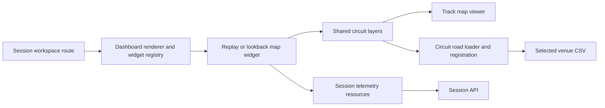

# Session review analytics

The session review API returns individual groups of observations and calculated values. The same groups serve dashboard panels and programmatic consumers. Each response has a session ID and an event-time cutoff. `GET /api/feature-metrics/review/catalog` lists stable output paths, units, methods and formulas. `POST /api/feature-metrics/sessions/{session_id}/review` accepts a subset of the nine groups and returns only those groups. Both routes use the app's authentication and dataset access checks.

## Workspace timing tower

The tower belongs to the session workspace and covers the full field across built-in layouts, saved layouts and sessions with no layout selected. On wide screens it starts just below the replay or lookback controls and stays visible beside the dashboard while it scrolls. The driver list scrolls independently. Collapsing the tower restores the full dashboard width. Narrow screens open the same table from a bottom dock in a dismissible sheet.

`GET /api/feature-metrics/sessions/{session_id}/timing-tower` returns compact, ordered position, interval, flag and lap observations from the stored session. Replay reads only observations visible at the current playhead and seeking requires no new fetch. Grand Prix and sprint sessions show the running order with either the gap to the leader or the gap to the car ahead. Reported gaps expire after 15 seconds. An asterisk identifies a gap from a recent shared lap crossing when reported timing is missing. A dash indicates unavailable data. Reported laps-down values retain their units. Lookback uses the final classification and its published gaps when stored, with compatible finish-line timing as a fallback. Qualifying and practice show best completed laps. Qualifying replay ranks session-wide best times and applies timing deletions and reinstatements at their recorded report times.

The 137 general analytics and 67 strategy primitives continue to serve existing callers. Race estimates now use `race_estimation_v2`. The common cutoff rules live in `domain/snapshot.py` and provider timestamp conversion lives in `domain/source_clock.py`. `domain/race_estimation/racing.py` supplies racecraft to both the previous estimate feed and the review API. `domain/strategy/pits.py` owns the shared net-loss calculation. Review modules in `domain/review/` handle lap geometry, pace, lapping, pit comparison, source observations and surface classification. `ReviewInput` reads canonical records and selects eligible history in PostgreSQL. `ReviewService` assembles only the requested analyses. The existing compute guard bounds simultaneous work.

| Group | Values and method | Limits |
| --- | --- | --- |
| `racecraft` | Battle means at least three same-target, adjacent timing reports over eight seconds and close headway on at least 75% of those reports. Consistent closing means four reports over twelve seconds, at least 0.15 s net reduction and decreases over 0.02 s in at least 75% of steps. | Timing intervals expire. Target changes, pit activity and neutralised phases break a sequence. A 1.2 s battle threshold is a project choice. |
| `racecraft` passes | A provider position-change report is corroborated by an adjacent swap, fresh close gaps before and after, green-flag evidence and a held order through the 12 s confirmation. The event appears after that hold and the publication margin. | OpenF1 also reports pit and penalty changes. The result is a conservative on-track estimate. Retakes, missing reports and closely spaced multi-car passes can be missed. |
| `racecraft` matchup | Median pace of the car ahead minus the follower's median. The panel also shows compound and tyre age from completed laps. A difference of 0.75 s/lap marks a large observed advantage. | Fuel, traffic, weather and car performance all contribute. A matchup does not imply a specific passing probability. |
| `drivers` | Source-supplied headshots and the best clean lap. For completed qualifying, the native per-phase result arrays are mapped to Q1/Q2/Q3. A unique rounded-millisecond time match links a reported result to a lap. | A repeated or absent lap duration leaves the link unresolved. Final phase results stay hidden before the end cutoff. |
| `segments` | Up to 12 explicitly chosen laps are projected onto a shared approved reference lap. For each equal-distance bin, interpolate crossing time, subtract crossings, and aggregate sampled minimum/maximum speed, throttle and binary brake. Purple is fastest among compared drivers, green beats a prior selected lap by the same driver, yellow is a slower comparable time. | These are app distance bins. Feed start clocks, samples and geometry limit precision. Missing or discontinuous position samples make the lap comparison unavailable. Native qualifying colour codes are shown separately and carry no duration. |
| `radio` | OpenF1's published clip metadata. The causal review group applies its provider-time cutoff. The archive timeline supplies the radio panel in Replay and Lookback. | Coverage depends on publication. Missing radio metadata can be recovered independently of telemetry. |
| `pace` | Median recent same-stint clean pace, faster empirical quartile, traffic/clear medians when coverage permits, and a robust stint slope. Track evolution compares the same driver, tyre, age bucket and dry temperature bucket across at least five minutes and three drivers. | Track evolution includes changes in fuel, effort and traffic. It cannot isolate rubber alone. The optional fuel scenario multiplies kg/lap by s/kg and keeps that component separate from the observed trend. |
| `pace` practice | Same-weekend dry slick runs, split by stint and consecutive lap numbers. At least five eligible laps are required and extreme pace outliers are excluded. The output includes pace scatter and observed clean run length by compound. | A soft-tyre hotlap run does not qualify solely because of its compound. Fuel load and session context limit transfer to race pace. Import the relevant practice session to include it. |
| `pace` projection | Fresh race gaps plus a configurable 1–20 lap horizon times recent median pace. The explicit fuel scenario applies a shared per-lap gain. Lapped cars retain their reported lap count. With synchronized positions, the catch scenario estimates phase at the encounter and reports a separate assumed delay range for a turn or straight. | Ordering applies to timed entries in the scenario. The model assumes constant average progress and has no maneuver, safety-car or unplanned stop simulation. |
| `pit` | Lane duration, stationary service and net loss are different values. Net loss adds in/out laps and subtracts nearby clean laps. The native report must match the in-lap number and plausible timing near the line. Release the sample after the following clean lap ends. Compute a median and robust scatter from at least three observations. | Green net loss is separate from SC/VSC and uses a matching rain flag where known. History includes earlier accessible same-circuit races or practice when already imported. Previous circuit layouts may differ. |
| `pit` rejoin | Add estimated net loss to the current gap and compare to the timed field. A rival within 0.75 s/lap on comparable recent pace can open a window. Compare today's margin with the margin obtained by removing the rival's excess service or lane duration. The stop need not be counted a second time. | The result is a conditional position flip. Other drivers are held fixed. A repair-time scenario needs a driver-specific damage report and a supplied extra time. The operation type and duration are unresolved by timing. |
| `incidents` | Publish driver-associated contact, damage, track limits and lap-deletion race-control reports. Keep the original wording. Count report category by driver. Compare several clean same-stint laps before and after an incident report where available. | An investigation and an official decision are distinct source messages. A pace loss remains an association. Approximate positions and brake-on samples cannot establish contact, damage or a locked wheel. The braking anomaly feed remains available. |
| `weather` | Plot the regional rain flag and the reported wind speed and bearing over the preceding 30 minutes. | OpenF1 supplies one circuit observation per minute with a boolean rain flag. Rainfall depth, local wetness, and the direction in which precipitation is moving require a separate spatial feed. Wind bearings are independent of the orientation of the telemetry map. |
| `surface` | Read racing surface, pit lane, gravel, runoff, recovery polygons and access points from a saved strategy context. Compare fresh telemetry with mapped boundaries outside the position error band. | Survey geometry must match the circuit configuration and session frame. Recovery distance is straight-line distance. |
| `flags` | Fold track-wide and marshal-sector flag reports through the replay cutoff. Combine with registered marshal polygons to highlight local cautions. | A sector number does not define an area. The map lists unmapped sector reports and only colours the entire circuit for global reports or neutralisation. |

The timing fields and media links are documented by OpenF1. FIA sporting regulations define track limits for the relevant season. The app keeps reports separate from geometry comparisons. [OpenF1 API](https://openf1.org/docs/) · [FIA 2025 sporting regulations, Article 33.3](https://www.fia.com/system/files/documents/fia_2025_formula_1_sporting_regulations_-_issue_4_-_2025-02-26.pdf)

Example for a replay consumer:

```json
{
  "as_of_ms": 10300000,
  "groups": ["racecraft", "pace", "pit"],
  "horizon_laps": 5,
  "fuel_burn_kg_per_lap": 1.5,
  "fuel_time_s_per_kg": 0.03
}
```

Omit `as_of_ms` for a final lookback. Supply `entry_ids` to filter driver output, while field comparisons retain field context. For `segments`, supply `laps` with `{ "entry_id": "…", "lap_number": 10 }` entries. Select a stored lap or request preparation from the panel. The review API reads stored car and position data, and preparation uses the existing telemetry worker.

The **Qualifying review** factory layout includes the Qualifying Lap Map, driver cards, lap comparisons, radio and weather. **Race strategy review** combines passes, pit benchmarks, a field projection, contact and track limits, radio and weather. Most panels subscribe to a single response per dashboard. A selected lap, projection scenario or registered surface context can request its own group. Same-session replay requests use a five-second floor on the clock. Free includes the basic timing, radio and weather panels. Analyst and Pro unlock the advanced models and inferred Race Updates. [Subscription access](14-subscriptions.md)

### Qualifying lap map

`GET /api/feature-metrics/sessions/{session_id}/qualifying-lap` accepts a timed lap and serves completed qualifying sessions. The three sectors use the reported split times. The app places the timing lines by interpolating where a reference car crossed them. The 20 minisectors are equal-distance bins on a shared reference lap. Their durations come from interpolated position crossings. Choosing Minisectors prepares the field's positions through the telemetry worker. Missing or discontinuous laps contribute no minisector time.

The panel ranks each driver's quickest eligible time per split across the session. Deleted, generated and known pit laps are excluded. The chosen lap is compared with the field best and the driver's personal best. Purple marks field best, green marks personal best, and yellow marks a slower split. Rankings display gaps to the field best and to the chosen lap, along with coverage counts.

### Driver cards and timing panels

Replay driver cards read the shared car telemetry feed. The speed trace uses the ten seconds leading up to the playhead. A gap over two seconds breaks the line and clears the current pedal and speed readings. Qualifying cards show the available phase results, gaps on a common scale and recorded segment colours. **Inspect lap** opens the matching timed lap when the layout includes the Qualifying Lap Map. The shared card header uses the team colour, car number and the source portrait where available.

**Tyre timeline** groups consecutive laps by recorded set and compound and leaves gaps where laps are missing. **Position history** plots the recorded order at lap completion in races and sprints. Both panels share the existing timing resource. In replay, a lap enters either visual only after its recorded end time. The panel's driver selector preserves the workspace selection.

**Tyre workload** plots the model's thermal, cornering, traction and wear-pressure indices on a shared scale. **Stint performance** compares up to eight recent clean laps from the most recent comparable set against the quickest displayed lap. Both panels provide the source and method details alongside the visuals.

### Strategy timing panels

**Race pace & projection** uses a common scale in seconds for the projected gaps to the leader. Driver focus keeps that scale. Lapped drivers retain their reported lap deficit. The pace chart compares recent medians with the fastest observed median, and an expandable table includes the absolute lap times and traffic evidence. **Pace context** compares the last clean lap with the prior same-set median and shows a separate traffic-associated difference when both cohorts are available.

**Pit loss & rejoin** shows a driver's estimated place among timed drivers if they stop at the current replay time. The benchmark chart shows the median and scaled median absolute deviation for net green-flag loss, lane time and stationary service as separate quantities. The rival comparison uses signed time margins from the reported and typical-stop scenarios. **Passes & battles** uses a shared seconds scale and the close-following threshold returned by the review API.

### Team radio timing

The panel fetches the published archive once through `GET /api/feature-metrics/sessions/{session_id}/radio-timeline`. When the stored OpenF1 radio is missing, `POST` on the same path fetches just `team_radio` and saves it on the existing session. A failed provider request is retryable and a successful empty response means the source supplied no clips. Replay reveals selected drivers' clips from the race start up to the current playhead. Lookback includes pre- and post-session clips when available. OpenF1 publishes a selection of radio. It copies Formula 1's capture feed `Utc` to `date`. [OpenF1 team radio documentation](https://openf1.org/docs/#team-radio) · [OpenF1 timestamp mapping](https://github.com/br-g/openf1/blob/main/src/openf1/services/ingestor_livetiming/core/processing/collections/team_radio.py)

For recognized audio filenames with a matching car number, the archive timeline interprets the filename clock as venue-local time. Imports store the OpenF1 `gmt_offset`. Older imports infer it only when at least three clips and three quarters of the parseable filenames agree on a 15-minute offset. The estimate uses the filename's whole seconds when it falls within the session clock and up to 120 seconds before the feed time. Both times are retained. The panel marks estimated recording times with `≈`. Other clips are labeled `Feed`. The filename convention and delay bound are heuristics and the published subset cannot establish complete radio coverage or the precise moment the driver spoke.

## Circuit maps and geometry registration

Engineering Desk, Race Spectator and Strategy Desk lead with a replay map. Race Review has a completed-session map. The map follows the selected drivers, and Focus follows an individual car. Replay markers use observed positions at or before the clock and expire after five seconds without a fix.

The shared circuit catalog resolves a venue from the OpenF1 circuit key. The frontend also accepts venue and event aliases for older imports. The same record selects the host flag, centreline and optional width profile. The 2026 Bahrain Grand Prix kept its name when it moved to Sepang, so its circuit key selects Malaysia's flag and Sepang's geometry. OpenF1 imports use the separate session key to keep the selected data tied to the correct session when timings change. [Circuit catalog](../../shared/circuit-catalog.json) · [Formula 1 venue announcement](https://www.formula1.com/en/latest/article/formula-1-and-fia-confirm-formula-1-and-fia-confirm-malaysia-will-join-2026-calendar-as-host-venue-for-the-bahrain-grand-prix.6lL7vjFEM2VVynRHvg1TCf)

The track maps use the same rigid registration against a closed observed lap. Each venue has one local centreline CSV, with an optional width profile in the same format. The road loader requests the active venue's profile first, then its centreline if needed. If neither aligns, the map draws the available telemetry outline. The track view keeps the original car positions and labels the road's provenance. The asset guide covers refreshing the files from pinned sources and adding a venue. [Circuit asset guide](../../frontend/public/circuit-roads/README.md)



The route owns session selection, URL state and layout composition. Workspace controls and telemetry status have their own components. The map widgets prepare the telemetry for their mode, and the shared layers compose the circuit, pits and conditions. The renderer takes geometry and frame data. The existing Enterprise Architect data flow from OpenF1 through storage and the session API still supplies telemetry.

Replay and all-lap lookback share a sampling budget that spans the complete timed session. A selected lap retains its source position fixes. If that lap is partial, the map can request one representative timed lap for the outline. An existing outline and its geometry stay fixed as the replay clock advances.

The pit lane is part of the base map in every layer. The backend first reads merged position windows around reported visits. If those cannot establish a route, it uses position samples between recorded pit crossings or looks for repeated departures from and returns to the racing line near out laps and stint changes. The geometric fallback needs matching routes from two drivers. The UI draws a dashed line for that estimate and can automatically prepare positions for up to two relevant drivers when the lane is missing. Pit lane in Focus changes the camera. Team box markers still appear as replay reaches the supporting stops.

The calendar check covered 93 race entries on 26 circuits from 2023 through 2026. The geometry tests register every bundled centreline and reject changed scale. Browser workflows checked real qualifying traces at Sakhir, Suzuka, Silverstone and Imola, and full-grid replay at Imola and Melbourne. Both replay fixtures measured about 17 ms at the 95th percentile for frame intervals at 1× and 5× under Chromium's 4× CPU slowdown. These timings measure playback after the data is ready. [Imola replay measurements](../testing/replay-map/circuit-audit-performance.json) · [Melbourne replay measurements](../testing/replay-map/circuit-audit-9693-performance.json)

Wind & rain uses the regional weather report at the replay clock or the end of a Lookback session. With a lap selected in Lookback, Wind & rain and Flags use the named driver's lap-end time. The animated arrows show the reported north-referenced bearing. A blue circuit outline indicates a rain report. The feed lacks per-corner rainfall and measured surface wetness. The map illustrates the compass bearing in screen space because telemetry frames can be rotated. [OpenF1 weather and location data](https://openf1.org/docs/)

FIA event drawings are useful references for validating the scheduled layout, sector labels and published length. Melbourne 2025 gives a 5.278 km centreline. Monaco 2025 and Melbourne 2026 publish emergency-exit plans. Use the matching event drawing to verify recovery data acquired from a licensed survey. The plans have different layouts and publication dates. [Melbourne 2025 circuit map](https://www.fia.com/system/files/decision-document/2025_australian_grand_prix_-_event_notes_-_circuit_map_pit_lane_and_quarantine_zone.pdf) · [Monaco 2025 emergency exits](https://www.fia.com/system/files/decision-document/2025_monaco_grand_prix_-_race_director_event_notes_-_emergency_exits_map.pdf) · [Melbourne 2026 emergency exits](https://www.fia.com/system/files/decision-document/2026_australian_grand_prix_-_competition_notes_-_circuit_map_pit_lane_drawing_emergency_exits_map_and_quarantine_zone.pdf)

OpenStreetMap can supply a candidate centreline and tagged features with attribution under ODbL. The Albert Park extract checked for this work contained a road tagged for emergency access, which does not establish a race-specific recovery opening. For surveyed Melbourne inputs, Data.Vic publishes some spatial datasets under Creative Commons terms. Check the specific dataset's licence, survey date and coverage. The 2025 Bahrain event notes also record an extended gravel bed at Turn 4, illustrating why the season matters. [OpenStreetMap licensing](https://www.openstreetmap.org/copyright) · [Albert Park access road](https://www.openstreetmap.org/way/1316267360) · [Data.Vic spatial licensing](https://www.land.vic.gov.au/maps-and-spatial/spatial-data/how-to-access-spatial-data/licensing) · [Bahrain 2025 event notes](https://www.fia.com/system/files/decision-document/2025_bahrain_grand_prix_-_race_directors_event_notes_.pdf)

1. Export the licensed geometry as a GeoJSON FeatureCollection. Each simple Polygon has a `kind` drawn from `racing_surface`, `pit_lane`, `gravel`, `runoff`, `recovery` or `marshal_sector`, an optional distinct `id`, and a one-based `sector_number` for marshal sectors. Split polygons with interior holes into simple polygons. Add each verified recovery access as a Point with `kind` set to `recovery_access`.
2. Prepare metadata with `circuit_key`, `coordinate_frame`, `source_uri`, `source_license`, `valid_season_from` and `valid_season_to`. Set `coordinate_frame` to `openf1:<session_id>:xy_metres` using the internal session ID. Add optional `circuit_length_m` from an event reference. Supply at least three non-collinear `landmarks`, each with a `survey` point and the matching `track_xy_m`. Use metres east and north or supply `origin_lon_lat` for local projection of longitude and latitude. Convert OpenF1 decimetre positions to metres before pairing landmarks.
3. From `backend`, run `python -m scripts.register_circuit_profile circuit.geojson profile-metadata.json`. Check alignment residuals and inspect independent landmarks. Submit the resulting JSON to `POST /api/strategy/sessions/{session_id}/contexts` as the layout owner.
4. Paste the returned context ID into the map's **Registered track context ID** field and choose a default layer. Replay and Lookback maps share the same layers. A context is session-specific and must be registered to the current frame again when it changes.

The backend uses surface and recovery geometry to refine stopped-car context. A car confidently inside a gravel, runoff or recovery polygon is matched against historical incident observations tagged with that terrain, as well as circuit, recovery distance, stop duration and time horizon. The standard strategy computation requires the configured minimum matching cohort before giving an SC or VSC estimate. A recovery point's proximity alone cannot determine the response. Detailed profiles and incident cohorts are supplied data. The factory layouts use telemetry outlines until they are registered. See the sporting regulations for the race director's deployment criteria. [FIA 2025 sporting regulations](https://api.fia.com/system/files/documents/fia_2025_formula_1_sporting_regulations_-_issue_4_-_2025-02-26.pdf)

To add a component, first identify the source, unit, as-of visibility and prerequisites. Implement a pure function in the existing group module or add a new group if it needs different inputs. Register the path and formula in the review catalogue. Keep observations, estimates and scenario assumptions explicit in the response. Verify numerical examples, missing input, the real API route and replay against later source rows. Add a typed frontend consumer when the component needs a panel.

The browser tests used Australian qualifying and race data plus Bahrain practice and race data. The Bahrain green pit benchmark was 23.27 s from 17 comparable samples at the chosen replay cutoff. The worker prepared two Australian Q3 laps in 12.107 s in a disposable schema. Both produced 20 equal-distance segments. These are measurements of the tested data and workflow. The remaining uncertainty comes from the source sampling, the model assumptions and the number of comparable observations. [Browser results](../testing/session-review-browser/results.json)
