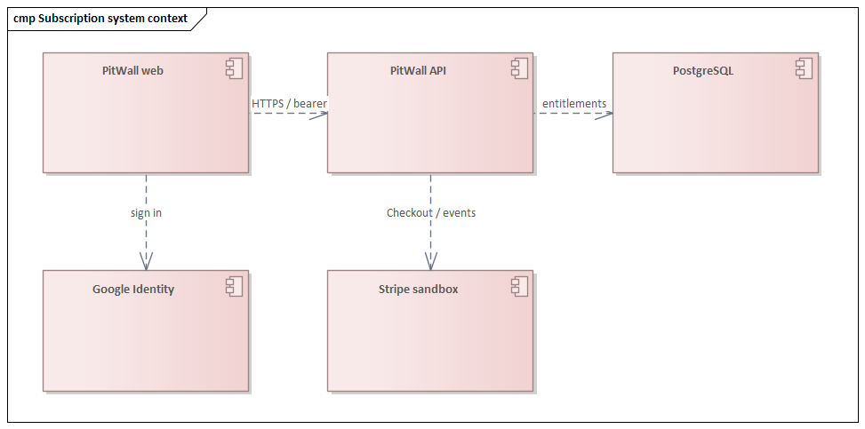
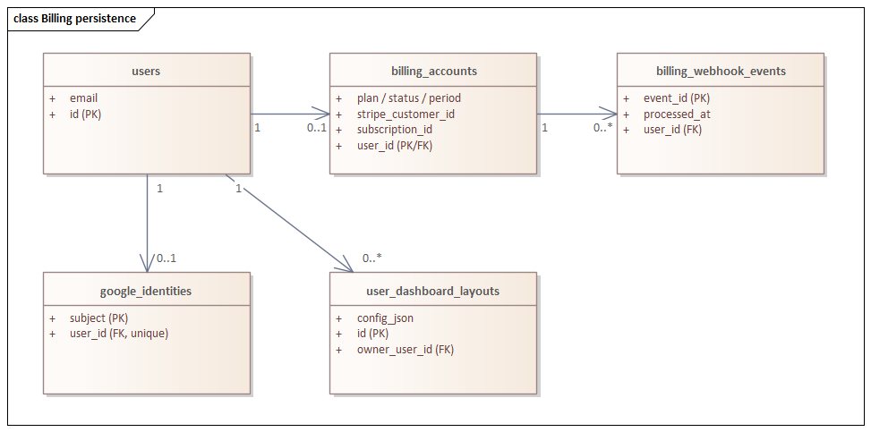
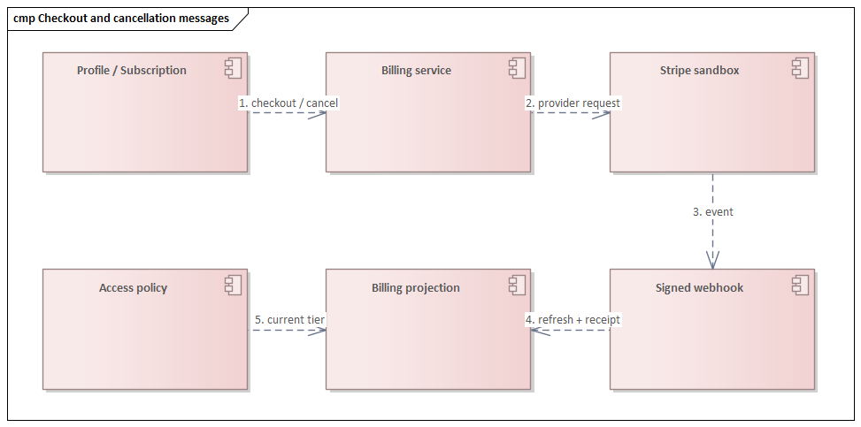
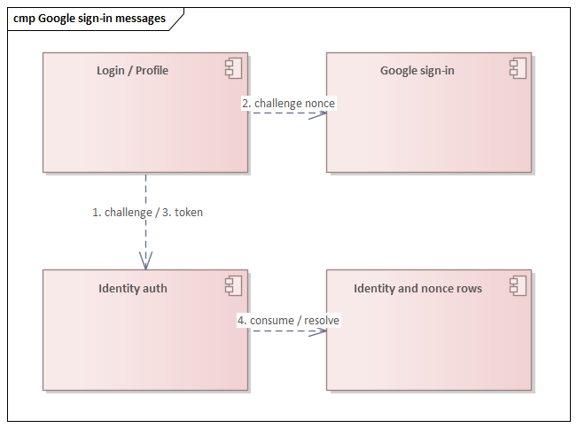

# Előfizetés és hozzáférés

## 1. Cél és termékhatár

A PitWall történeti F1-elemzéshez három csomagot ad. A Free teljes idejű Replay és visszatekintő hozzáférést ad minden támogatott munkamenethez. Az Analyst a teljes mérnöki és stratégiai eszköztárat nyitja meg. A Pro nagyobb szerkesztői keretet ad, és a tervezett teljes MI-eszköztár célcsomagja. A fiók azonosítása, az előfizetés és az OpenF1-adatok jogosultsága három külön felelősség.

## 2. Csomagok és árazás

| Képesség | Free | Analyst | Pro |
| --- | ---: | ---: | ---: |
| Tesztár havonta | 0 Ft | 1 490 Ft | 2 490 Ft |
| Tesztár évente, egy összegben | 0 Ft | 14 900 Ft | 24 900 Ft |
| Mentett saját elrendezések fiókonként | 2 | 10 | 30 |
| Panelpéldány saját elrendezésenként | 4 | 10 | 20 |
| Időmérő torony, térkép, köridők, történeti Replay, rádió | ✓ | ✓ | ✓ |
| Mérnöki elemzés | Nyers sebesség-, gáz-, fékgörbe és köridők | Teljes modellkészlet | Teljes modellkészlet |
| Versenystratégia | Megfigyelt etaptempó és gumihasználat | Boxkiállás, riválisforgatókönyvek, időjárásváltás, tempó-előrejelzés | Teljes modellkészlet |
| MI, tervezett sikeres válasz naptári hónaponként (UTC) | 0 | 500, összefoglaló és összehasonlítás | Korlátlan, ezenfelül munkamenet-kérdések és Replay kör-összefoglaló |

A termékcél kilenc alapszinten használható terület tízből. A tíz terület: munkamenet-archívum, Replay, visszatekintés, pályatérkép és időmérés, rádió és hivatalos jelentések, nyers telemetria, mérnöki vizsgálat, stratégiai vizsgálat, saját elrendezések, MI. Az első kilencben a Free legalább egy ismételhető feladatot ad. A 9/10 az elérési szélességet méri. A paneldarabszám, a modellek részletessége és az MI-keret külön mérőszám. A megfigyelt etaptempó ugyanabban a Replay-ben vizsgálható, amelyben az Analyst előrejelzést futtat. A Free szinten nincsen óra, próbaperiódus vagy automatikus fizetős átváltás.

Az MI-keretek termékdöntések. A jövőbeli metering a sikeres válaszokat számolja, fiókonkénti UTC hónappal, előzetes atomi foglalással és kérésazonosítóval. Hibánál a foglalás felszabadul. A Pro díja tesztár, a magasabb keret értéke az MI bevezetésétől függ. Éles termékár előtt költség- és fizetési hajlandósági mérés kell.

Az éves ár tíz havi díjnak felel meg, így tizenkét havi fizetéshez képest 16,7% a kedvezmény. A HUF-árak magyar prototípushoz választott termékhipotézisek. Piaci támpont a videót is kínáló F1 TV havi Pro csomagja, amely a magyar App Store termékoldalán 3 290 Ft-tal szerepelt a tervezéskor. A PitWall történeti elemzésre áraz. [F1 TV csomagok](https://f1help.formula1.com/article/F1-TV-subscription-comparison) · [Magyar App Store](https://apps.apple.com/hu/app/f1-tv/id1315007279?platform=tv)

## 3. Panel- és elrendezésszabályok

A `shared/dashboard-widgets.json` adja a panel minimális szintjét. Az összes csoportban szereplő panelpéldány külön számít. A gyári elrendezés a legmagasabb hozzáférési szintű paneljét örökli. A Replay Focus, a Session trends és az etapnézet Free. Az Engineering desk, a Race strategy és a Strategy desk Analyst szinttől megnyitható. A saját elrendezések egyetlen fiókkvótán osztoznak a visszatekintő és Replay nézetek között. A kedvencek külön tulajdonságként működnek.

A jelenlegi katalógus 42 munkamenet-paneléből 16 Free, további 26 Analyst. A két platformwidget külön kategória. A Race Updates panelen minden csomag szűrhet zászlókra, boxkiállásokra és kiválasztott pilótákra. A pálya aktuális állapota a szűrőtől függetlenül látszik. Analyst és Pro csomagban a fékezési anomáliák, lehetséges incidensek és álló autók jelöltjei külön szűrőkkel jeleníthetők meg. Ezek a modellezett jelzések alapértelmezésben rejtve vannak. A pályatérképen az alap, időjárás, zászló és boxréteg Free. A hitelesített pályafelület rétege és az időmérős miniszektorok Analyst képességek.

Visszaváltáskor a saját konfiguráció megmarad. A módosítás csak olyan elrendezést menthet, amely belefér az aktuális panelkeretbe és paneljogosultságba. A teljes kereten túli meglévő elrendezésekből a legrégebbiek maradnak megnyithatók, az újabbak a könyvtárból továbbra is szerkeszthetők vagy törölhetők. Törléskor felszabadul a hely. A panelkorlát vagy a csomag miatt zárolt elrendezés helyett a munkaterület elérhető gyári ajánlást választ. A jogosultság az elrendezés hozzáférését befolyásolja. A munkamenet órája és az elemzési időhatár közös marad. [Elrendezésszerkesztő](07-dashboard-builder-foundation.md)

## 4. Rendszer- és komponensarchitektúra

A `billing` modul feladata a csomagkatalógus, az effektív jogosultság, a Stripe adapter és a számlázási vetület. A `delivery_api` kezeli a HTTP-határt, a `dashboard_layouts` a szerkezeti és előfizetési korlátokat, az `identity_auth` a helyi és Google-azonosítást. Az elemző végpontok külön ellenőrzik a fiók jogát, mielőtt a számítást vagy a gyorsítótárat elérnék. A telemetria-import és az időbélyeges replay-szűrés a meglévő modulokban fut. [Backend](02-backend-architecture.md) · [Stratégia](10-strategy-foundation.md)



## 5. Adatmodell

| Adat | Tárolás | Rendeltetés |
| --- | --- | --- |
| Fiók, e-mail, meglévő opcionális megjelenítési név és kapcsolat | `users`, `account_profiles` | Bejelentkezés, munkaterület, választható profiladatok |
| Stripe-ügyfél, aktuális előfizetés, csomag, ciklus, állapot, időszak vége, megújítás leállítása és átmeneti Checkout-hivatkozás | `billing_accounts`, fiókonként egy sor | Jogosultságvetület, megújítás kezelése, párhuzamos Checkout kérések összehangolása |
| Stripe eseményazonosító és feldolgozás ideje | `billing_webhook_events` | Ismételt kézbesítések kiszűrése, fiókhoz kötött takarítás |
| Google `sub` és PitWall-fiók kapcsolata | `google_identities` | Stabil identitás, egy Google-fiókhoz egy helyi fiók |
| Rövid élettartamú Google-kihívás lenyomata | `google_login_challenges` | Egyszer használható nonce ellenőrzése |
| Számlázási cím, fizetési mód, számla és a fizetés hitelesítése | Stripe Checkout / Customer Portal | Számlázás és szolgáltatói ügyfélkezelés |

A személyes számlázási adatok a Stripe oldalán adhatók meg és kezelhetők. A fizetős profilban a felhasználó a számlázási címet fizetéskor tölti ki. A PitWall adatbázisában nincs kártyaszám, CVC, teljes cím, webhook-törzs vagy Google-token. Az átmeneti belépési rekord lejárata tíz perc. A webhook-azonosítókhoz 30 napos tervezett üzemeltetési megőrzés tartozik. Éles szolgáltatásnál külön kell rögzíteni a számlák jogszabályi megőrzését, a szolgáltatói adattörlés folyamatát és a feldolgozói szerződés szerepköreit. [GDPR 5., 6., 25., 28. és 32. cikk](https://eur-lex.europa.eu/eli/reg/2016/679/oj/eng) · [Stripe fizetési biztonság](https://docs.stripe.com/security/guide)



## 6. HTTP-szerződések és jogosultságok

| Felület | Hozzáférés és eredmény |
| --- | --- |
| `GET /api/billing/plans`, `GET /api/billing/me` | Ár és keret, illetve az azonosított fiók aktuális előfizetése |
| `POST /api/billing/checkout`, `/portal`, `/cancel`, `/sync` | Tulajdonosi fiók. Checkout, számlázási portál, leállítás, állapotfrissítés |
| `POST /api/billing/webhook` | A nyers kérésre ellenőrzött Stripe-aláírás, tesztesemények, atomikus állapot és eseménynyugta |
| `POST` és `PUT /api/layouts` | Tulajdonosi ellenőrzés, szerkezeti séma, csomagjog és létrehozási kvóta |
| Versenybecslés, részletes analitika, pontszámok és döntési jelzések | Analyst vagy Pro |
| Hivatalos versenyjelentések | Free, nyers forrásjelentések az aktuális Replay-időhatárig |
| Stratégiai értékelés, Replay-forgatókönyv, stratégiai kontextus | Analyst vagy Pro |
| Session review, vegyes kérés | A csoportok közül a legmagasabb szükséges szint. Pilótakártyák, hivatalos jelzések, időjárás és rádió Free. Modellezett tempó, újraérkezés, versenyhelyzetek és szegmenselemzés Analyst. |
| `POST /api/auth/google/challenge`, `POST /api/auth/google` | Rövid élettartamú kihívás, ellenőrzött Google-belépés vagy hitelesített kapcsolás |

## 7. Checkout és jogosultsági állapot

1. A felhasználó jóváhagyja a csomagot, a teljes ismétlődő összeget, a ciklust és a megújítás tényét. A szerver saját katalógusból választ árat. A Checkout kártyás tesztmódban fut, címbekéréssel.
2. A visszaérkezés a Profil előfizetési lapjára vezet. A hozzáféréshez a Stripe API aktuális előfizetési és számlaállapota szükséges. A webhook ezt frissíti. Az állapot kézzel is újra lekérhető ugyanannak a fióknak.
3. A fizetett hozzáférés feltétele az aktív előfizetés, a fizetett legutóbbi számla és az érvényes időszak. Sikertelen első fizetés, lejárt időszak vagy rendezetlen megújulás esetén Free jár. A Stripe ismétléseinél az eseményazonosító egyedi. A beérkezési sorrend helyett a szolgáltatónál aktuális állapot számít.
4. Az előfizetési lapon a „Megújítás leállítása” után egy megerősítés kell, így a közös profiloldalról két művelet elég. A fizetési út ennél hosszabb, mert a választás és jóváhagyás után következik a szolgáltatói űrlap. Az oldal megjeleníti a hatálybalépés dátumát. A fizetett hozzáférés az időszak végéig él. Meglévő fizetős csomag váltása a tesztben az időszak lejárta után választható. Éles váltásnál a következő időszakra ütemezett visszaváltás és az előre kijelzett részidőszakos díjjal induló azonnali bővítés külön folyamat.

[Stripe Checkout](https://docs.stripe.com/api/checkout/sessions/create) · [Stripe események és sorrend](https://docs.stripe.com/webhooks) · [Stripe Customer Portal](https://docs.stripe.com/customer-management)



## 8. Google bejelentkezés

A frontend a Google hivatalos gombját használja. A szerver ellenőrzi az aláírást, kibocsátót, címzettet, lejáratot, ellenőrzött e-mailt és a nonce-t. A PitWall munkamenetéhez a Google `sub` alapján hozzárendelt belső azonosító kerül. Meglévő helyi e-mail esetén a regisztráció ütközést jelez. Az összekapcsolást a belépett fiók tulajdonosa kezdeményezi és a jelenlegi jelszóval igazolja. [Google OIDC](https://developers.google.com/identity/openid-connect/openid-connect) · [Google Identity Services](https://developers.google.com/identity/gsi/web/reference/js-reference)



## 9. Fogyasztói jogok és adatbiztonság

A megújítás online, ugyanabban a profilban állítható le, ahonnan az előfizetés indítható. A felület a fizetés előtt megmutatja a ciklust, az automatikus megújítást és a teljes összeget. A leállítás indoklás nélkül elérhető. A magyar és EU-s elállási funkció ettől külön áll. Az arra jogosult fogyasztónál jól látható és a határidő alatt elérhető online nyilatkozat, külön megerősítés és tartós adathordozón időbélyeges visszaigazolás kell. Az éles bevezetéshez szükséges a szolgáltatás besorolása, az elállási és visszatérítési folyamat, az ÁSZF, a magyar számlázás és az áfa kezelése. [2023/2673/EU, 11a. cikk](https://eur-lex.europa.eu/eli/dir/2023/2673/oj/eng) · [Magyar Közlöny, 2025. évi 157. szám](https://magyarkozlony.hu/dokumentumok/07b1e2fdffc8e80dff43e39b1b01b4a955ad4441/letoltes)

Az egyszerű megújítás-leállítás termékcél. Az Egyesült Államokban a ROSCA előír egyszerű leállítási mechanizmust az alkalmazási körében. Az FTC 2024-es kibővített szabályát 2025-ben megsemmisítette a bíróság. Új piac megnyitásakor az adott ország és régió előírásait kell ellenőrizni. [FTC, 2026-os szabályalkotási dokumentum](https://www.ftc.gov/system/files/ftc_gov/pdf/p064202negativeoptionruleanprm.pdf)

A tesztintegráció kizárólag tesztkulccsal indulhat, a kulcsok és webhook-titkok a szerveren maradnak. A hosztolt kártyaűrlap csökkenti a PCI DSS hatókörét és kezeli a kártyás hitelesítési lépést. Élesítés előtt feladat az alkalmazható PCI-önértékelés, a TLS, a kulcsforgatás, a webes munkamenet és hozzáférési napló felülvizsgálata, valamint az adatbázismentés. A szerződéskötés igazolásához rögzíteni kell az elfogadott feltételek verzióját, a megújítás jóváhagyását és idejét. Az éles webhook-kézbesítéshez figyelés és rendszeres szolgáltatói egyeztetés szükséges. [Stripe integrációs biztonság](https://docs.stripe.com/security/guide)

## 10. Tesztüzemi beállítás

A Stripe Sandbox környezetben hozz létre két terméket és négy ismétlődő HUF-árat. Az API kisebb pénzegységben adja vissza az összeget. A katalógus 1 490 Ft-os árát például 149 000-ként ellenőrzi. A `backend/.env` fájlba a Stripe Sandbox kulcs, a webhook aláíró titka és a négy Price ID kerül. Az opcionális `STRIPE_PORTAL_CONFIGURATION` egy tesztportál-konfigurációra mutat. A Customer Portalban engedélyezd a számlázási adatok és számlák kezelését. A csomagváltást kapcsold ki. A PitWall profil kezeli az időszak végi megújítás leállítását. [Stripe HUF pénznem](https://docs.stripe.com/currencies) · [Stripe portálbeállítás](https://docs.stripe.com/customer-management/configure-portal)

| Változó | Tesztérték vagy rendeltetés |
| --- | --- |
| `WEB_APP_URL` | `http://localhost:5173`, illetve a böngészőben megnyitott webalkalmazás címe |
| `STRIPE_TEST_SECRET_KEY`, `STRIPE_WEBHOOK_SECRET` | Az elkülönített Sandbox szerverkulcsa és az eseményfogadó titka |
| `STRIPE_ANALYST_MONTH_PRICE`, `STRIPE_ANALYST_YEAR_PRICE` | 1 490 Ft havi és 14 900 Ft éves Sandbox Price ID |
| `STRIPE_PRO_MONTH_PRICE`, `STRIPE_PRO_YEAR_PRICE` | 2 490 Ft havi és 24 900 Ft éves Sandbox Price ID |
| `GOOGLE_CLIENT_ID` | OAuth webkliens, a `WEB_APP_URL` originje az engedélyezett JavaScript originek között |

Jelentkezz be a `stripe login` paranccsal, és válaszd ugyanazt a Sandbox környezetet, amelyben az árak vannak. A helyi API-ra a következő parancs továbbítja az eseményeket. A parancs által kiírt `whsec_` értéket írd a `backend/.env` állomány `STRIPE_WEBHOOK_SECRET` változójába, majd indítsd újra az API-t. Az alkalmazás indítóparancsa futtatja az `alembic upgrade head` lépést is. [Stripe CLI bejelentkezés](https://docs.stripe.com/cli/login) · [Stripe CLI listen](https://docs.stripe.com/cli/listen)

```powershell
stripe listen --all-snapshot --forward-to http://127.0.0.1:8000/api/billing/webhook
```

A fizetési próba menete a profil **Subscription** lapjának megnyitása, egy havi vagy éves csomag kiválasztása, a Stripe fizetőoldalán a `4242 4242 4242 4242` tesztkártya használata, majd a csomag megjelenésének ellenőrzése. Használj jövőbeli lejáratot, háromjegyű CVC-t és kitalált számlázási címet. Ha a profil még Free csomagot mutat a visszatérés után, a **Refresh status** gomb újra beolvassa a Stripe állapotát. Teszteld az Analyst és a Pro csomagot külön PitWall-fiókokkal. A megújítás leállítása után az időszak vége látszik a profilon. A Stripe tesztkártya-táblázata külön eseteket ad az elutasításra és a 3D Secure-hitelesítésre. [Stripe tesztkártyák](https://docs.stripe.com/testing)

## 11. Ellenőrzés és készültség

Az izolált tesztek vizsgálják a Free, Analyst és Pro szerveroldali hozzáférést, a közvetlen API-hívást, a kvóta és paneljog határait, a lejárat utáni visszaváltást, az ismételt Stripe eseményt és a hibás aláírást. A Stripe és Google kódja az alkalmazásban használható integrációs pontokat ad. Szolgáltatói végpontokkal végzett igazolás külön mérést kap, amikor a Sandbox és Google webkliens elérhető. Az MI négy tervezett eszköz, címkézett keretekkel és hívás nélkül. Implementációjakor az aktuális replay-időhatárt a szerveren is meg kell őrizni.

| Próba | Eredmény 2026. november 20-án |
| --- | --- |
| PostgreSQL-migráció és a modell egyezése | Alembic upgrade és check sikeres |
| Backend | 217 teszt sikeres, köztük az aláírás, az ismételt kézbesítés és a kvóta párhuzamos kérése |
| Frontend | 66 teszt, lint és build sikeres |
| Chromium | Éves ár, Free és Analyst kvóta, zárolt Replay link helyettesítése, két műveletes megújítás-leállítás tesztválasszal, lejárat utáni Free állapot. A teljes elrendezésszerkesztő-próba Pro tesztfiókkal sikeres. |
| Hosztolt fizetés és Google-fiók | Szolgáltatói hitelesítők szükségesek |

A tervezés és a dokumentáció szerkesztése során MI-eszköz is közreműködött. A termékdöntések és a futtatási eredmények visszakereshetők a forráskódból és az ellenőrzésekből.
