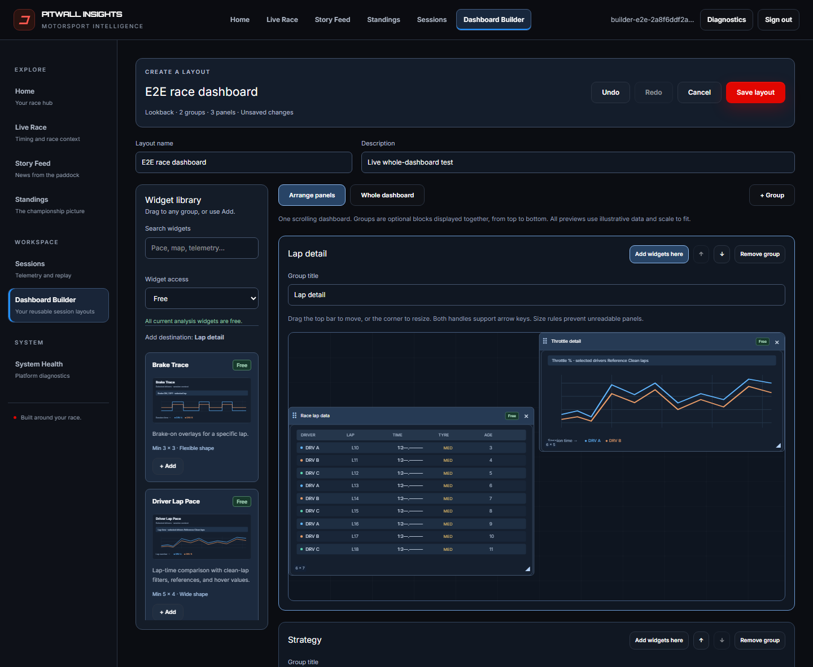
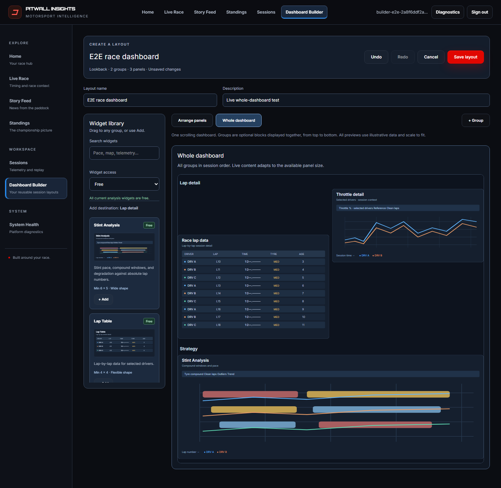
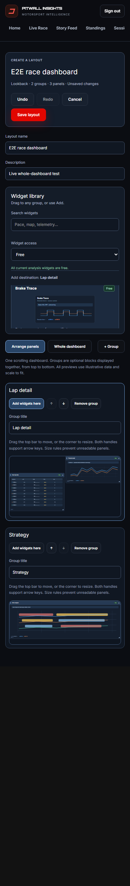
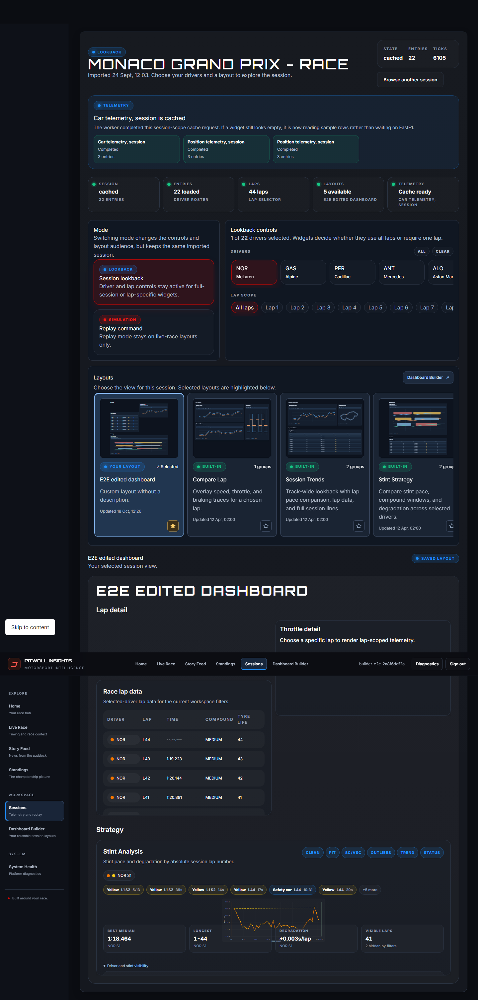

# Layout Builder Validation

Verified against the running local PostgreSQL-backed API and the frontend production preview on 2026-10-18. Temporary accounts and their layouts/favorites were removed after the checks. Existing profiles and credentials were not used.

## Results

| Check | Result |
| --- | --- |
| Frontend production build and ESLint | Pass |
| Eleven Node tests: placement, collision/bounds, available space, serialization, empty drafts, template arrangement, resize clamping and stable limits across every widget | Pass |
| Four backend test methods against the live API/database, including multiple cases per method | Pass |
| Actual browser sign-in, session-only widget catalog, search/access filters and Free badges | Pass |
| System Health and Sessions excluded from the editor and rejected by API validation | Pass |
| Every group visible, group ordering, whole-dashboard view and proportional chooser previews | Pass |
| Widget-specific minimum and aspect rules; compact table blueprints and API rejection of invalid sizes | Pass |
| Runtime compact/short modes respond to panel size; short stint controls remain accessible in a disclosure | Pass |
| Native palette drag/drop, pointer move/resize, keyboard movement, numeric collision rejection | Pass |
| Pointer, keyboard and numeric resize clamp at minimum/maximum sizes, aspect limits, grid edges and neighboring panels; repeated boundary requests do not add undo steps | Pass |
| Panel titles/options, duplication/removal, group creation/removal and reordering | Pass |
| Undo/redo, all-group editing, unsaved navigation protection and cancel/discard | Pass |
| Save failure retains the draft; retry persists to the owner's database profile | Pass |
| Editing keeps the same record; clearing descriptions and reloading persist | Pass |
| Factory Edit/Delete absent; template copy leaves factory definitions intact | Pass |
| Favorite/unfavorite persists; favorites sort first inline in the session picker | Pass |
| Favorite and deletion failures preserve the existing state and allow retry | Pass |
| Saved grids mount real widgets in an existing imported session with a selected driver | Pass |
| Replay creation exposes compatible widgets only | Pass |
| Two accounts cannot read/update/delete/favorite one another's personal layouts | Pass |
| Switching accounts in one browser does not reuse personal layout/favorite caches | Pass |
| New layout stays reachable while scrolling a library with 17 layouts | Pass |
| Editor/library fit 390, 768, 1280 and 1600 pixel viewports; no browser runtime errors | Pass |

All current widgets are free. Subscription filters are tested as empty collections; no paid plans or billing provider are implemented. The editor shows widget-specific structural previews. Chooser cards and Whole dashboard show all groups in the same proportions. Session data is rendered in Sessions. The build retains a non-blocking bundle-size warning (about 559 kB before gzip).

## Reproduce

Run the backend using its existing virtual environment and apply migrations from `backend`:

```powershell
.\.venv\Scripts\python.exe -m alembic upgrade head
.\.venv\Scripts\python.exe -m unittest discover -s tests -v
```

From `frontend`:

```powershell
npm run test
npm run build
npm run lint
npm run preview -- --host 127.0.0.1 --port 4173
```

The end-to-end runner requires Python with Playwright and its Chromium browser (`python -m pip install playwright`, then `python -m playwright install chromium`). From the repository root, with the backend on port 8000 and an imported session containing entries already available:

```powershell
$env:PITWALL_FRONTEND_URL = 'http://127.0.0.1:4173'
python frontend/tests/layout-builder.e2e.py
```

The browser runner signs in through the real UI, exercises the live APIs, and checks persisted documents with direct API reads. Only the deliberate save/favorite/delete failure cases intercept requests. It writes screenshots to the operating system's temporary `pitwall-layout-builder-e2e` directory. Test-account cleanup uses the backend virtual environment; the runner currently expects its Windows `Scripts/python.exe` path.

## Screenshots

The editor, including its widget library and builder-only Free badges:



Whole dashboard displays all groups together:



The narrow editor scales its design canvas to fit and keeps every group visible; Add buttons and numeric controls are alternatives to dragging:



A saved custom layout rendering real lap data and other registered widgets in an imported session, with inline favorite stars in the picker:


